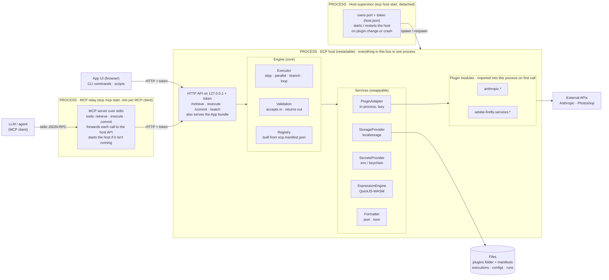
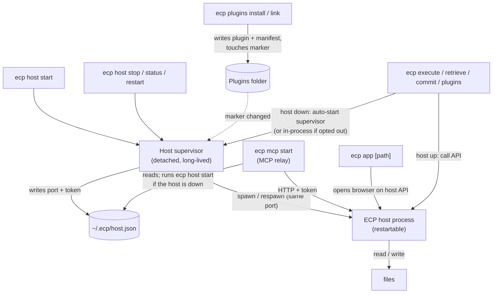
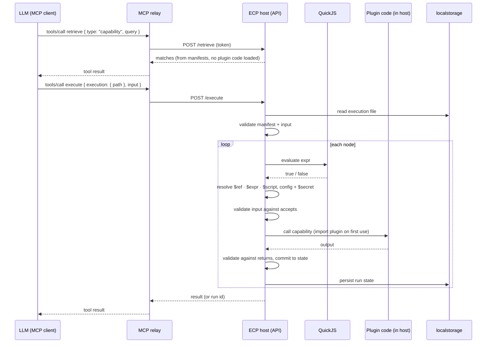
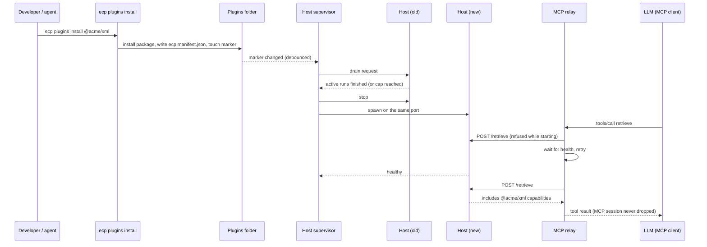
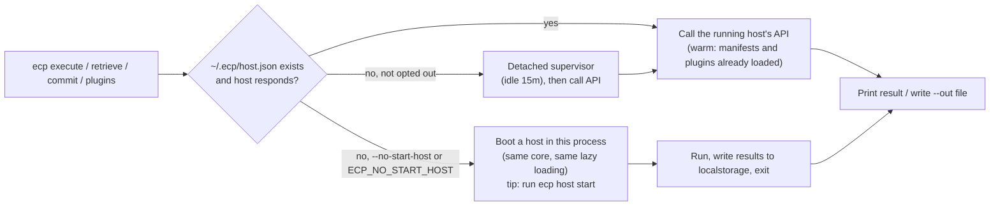

# ECP Realignment Plan

> **Status:** MVP shipped / milestone merged 2026-11-15 (PR #68 into `development`). Spec remains
> the contract; audit fixes in [`realignment/mvp-audit-fixes.md`](realignment/mvp-audit-fixes.md).
> **Build from the spec:** [`realignment/spec/`](realignment/spec/README.md) holds the exact MVP contracts and
> [`realignment/`](realignment/README.md) the phase docs. Where this plan and the spec differ, the spec wins.
> This plan is the source of truth for the realignment. It replaces the CLI reset plan
> (`RESET-PLAN.md` and `reset/`, retired 2026-11-14; what still applies is in "Carried over from
> the CLI reset", and the originals are in git history at `27238c96`). Phase docs live in
> [`realignment/`](realignment/README.md).
> Implementation started with Phase 0 (groundwork); see "MVP build".
> Grounded in `development` @ `5a523783` (2026-11-04).

ECP becomes an **ECP host**: one restartable process that holds the engine (executor, validation, registry), a service container, and an **HTTP API** with three operations (`retrieve`, `execute`, `commit`). It runs **execution manifests** (formerly workflow manifests) and validates every capability call against accepts/returns schemas. **Plugins load inside the host**, deferred the way oclif does it: the registry comes from per-plugin manifests and plugin code is imported on first call. A small **host supervisor** (`ecp host start`) keeps a warm host running and restarts it on plugin changes or crashes. The **MCP relay** (`ecp mcp start`) is a thin stdio MCP server that forwards the three tools to the host API, so MCP clients stay connected across host restarts. CLI commands, the App and scripts are clients of the same API. Every key component is a **service**: an interface with swappable implementations registered at environment setup (`environment.use(Impl, Interface.service)`), OSGi-style but without runtime lifecycles or ranking. The MVP ships local implementations only. The Fluent TS API becomes an SDK that generates manifests.

## Scope

**MVP (in):** execution manifest v2; the ECP host with the service container and its localhost HTTP API; in-process deferred plugin loading (`LocalPluginRegistration`); the host supervisor; the MCP relay with the three tools; config objects and local secrets; JSON and TOON formatters; local file storage; the oclif CLI (`ecp host`, `ecp mcp`, `ecp app`, one-off operations, plugins, secrets); the App (view and run); the TS Fluent SDK.

**Later (designed for, not built):** remote plugin hosts (HTTP, Lambda) and the host-to-plugin-host signing protocol, caller auth beyond the local token (API keys, OAuth), MCP over HTTP, SQLite and hosted stores, running the host in short-lived functions. See "Later".

**Out for now:** policies (budget, approval, state-control, registry-control), editing in the App canvas, the browser environment, harnesses/evals, Reflex. The executor keeps a before/after-call hook where policies can attach later, nothing more.

## MVP decisions (final, 2026-11-14)

These override anything below that reads otherwise. Details are in the spec.

- **JSON is the only execution format in the MVP.** The host accepts manifests inline, by `id`, by `path`, or by `id` + patch. No Fluent parsing in the host.
- **The Fluent SDK is a separate post-MVP phase** ([`realignment/post-mvp-fluent-sdk.md`](realignment/post-mvp-fluent-sdk.md)). It produces JSON at build time; no MVP phase depends on it. Sections below that discuss Fluent as an authoring format describe that later phase.
- **The host is the validation authority.** Four layers (load, schema, semantics, data flow, plus run input); one `ValidationResult` with codes, JSON Pointers, suggestions and available refs on every surface; `execute { mode: "validate" }` for the fix loop (spec 03, 06).
- **Plugin manifests carry `accepts`, `returns` and the config schema.** The host validates execution structure with one base validator, compiles each capability's raw `accepts` lazily, filters marker-explained schema errors outside the schema, and keeps a separate editor dispatch schema (spec 03). Data-flow still checks every `$ref` against `returns`: order, maybe-missing outputs after gates/branches/loops, path existence, type fit, parallel isolation, write conflicts.
- **`$script` can reference a file** (`path`) as well as inline `source` (spec 02).
- **Commit modes:** `create`, `replace`, `merge`, `append`. The legacy `version` mode behaved exactly like `replace` and is dropped.
- **Layout:** Phase 0 moved all legacy code to `legacy/` outside the workspace; Phase 9 deleted that tree. New packages live in `packages/` and `plugins/` (spec 01).
- **Packages:** `protocol`, `engine`, `quickjs`, `formatters`, `local`, `plugin-sdk`, `host`, `mcp-relay`, `cli`, `app`, and plugins `plugin-test`, `plugin-anthropic`, `plugin-azure-blob-storage`, `plugin-adobe-firefly-services` (spec 01, 08).
- **Done means** the 12 acceptance scenarios in spec 12 pass in CI on Ubuntu and Windows.

## Repo and branch

Historical (decided 2026-11-14, superseded 2026-11-15): the realignment happened in **this repo on `milestone/realignment`**, cut from `development`.

- The existing packages stayed as **legacy reference code** until each one was replaced. Read them for what to carry over (see "What carries over"); don't extend them.
- Agent rules (`AGENTS.md`, `CLAUDE.md`, `.cursor/rules/`, `skills/ecp-core/`) were rewritten for this plan before any code, so agents don't follow the reset-era rules. `RESET-PLAN.md` and `reset/` are history.
- **Layout of new code** (decided): Phase 0 moves legacy code to `legacy/` (out of the workspace and CI); new code goes in `packages/` and `plugins/`; Phase 9 deletes `legacy/`.
- The npm scope `@executioncontrolprotocol/*` is published up to 0.52.x. Releases from this milestone are a new major version; decide package names before the first publish.
- Pushes to `main` publish to npm. Work merges into `milestone/realignment` through PRs; nothing goes to `development` or `main` until the milestone is released.

**Post-merge (2026-11-15):** `development` is the integration branch. Branch `fix/*` or `feat/*`
from `development` and open PRs into `development`. Never push to `main` (publishes to npm).
`milestone/realignment` is merged history (PR #68).

## Vocabulary

| Term | Meaning |
| --- | --- |
| **Execution** | What a workflow used to be: one or more steps plus routing logic (branch, loop, parallel, gating). A single step is a valid execution |
| **Execution manifest** | The JSON document describing an execution. Canonical artifact |
| **Capability** | One callable unit with an `accepts` and `returns` schema, e.g. `@executioncontrolprotocol/azure-blob-storage.list` |
| **Plugin** | An npm package that provides capabilities (and their config schema), and nothing else. Loaded into the host process on first call |
| **Plugin manifest** | `ecp.manifest.json` shipped with each plugin: capability ids, accepts/returns as JSON Schema, config schema. The registry is built from these without loading plugin code |
| **Service** | An interface for a key component of the host (storage, formatting, secrets, plugin loading…), identified by a service id |
| **Service implementation** | A class implementing a service, registered with `environment.use(...)`, identified by an implementation id. Never runs inside an execution |
| **ECP host** | The restartable process that holds the engine (executor, validation, registry), the service container, loaded plugins and the HTTP API |
| **Host supervisor** | A small detached process (`ecp host start`) that owns the host's port and token, starts it, and restarts it on plugin changes or crashes |
| **MCP relay** | A thin stdio MCP server (`ecp mcp start`) exposing `retrieve`/`execute`/`commit` and forwarding each call to the host API. Runs no capabilities; one per MCP client |
| **Object** | Anything the host stores and that `retrieve`/`commit` work on: capabilities, executions, configs, runs |

## Architecture

Decided 2026-11-14: no separate plugin process and no IPC protocol. The host loads plugins in-process and is restarted as a whole; a supervisor keeps it warm and an MCP relay keeps MCP clients connected.

### Components



- The relay only translates the three MCP tools into host API calls. It never runs capabilities and doesn't own the host; several relays can share one host.
- The supervisor owns the host's lifecycle: port and token, restarts on plugin changes and crashes, `ecp host stop / status / restart`.
- There is no plugin process. Plugin code is imported into the host on first call; the registry comes from manifests. A plugin change restarts the whole host.
- The executor is part of the host's engine.

### Processes and files (local mode)



### An execution through MCP



### Installing a plugin while an agent is connected



### How a one-off CLI command finds a host



### ECP host

- **One process, restartable as a whole.** Engine (executor, validation, registry), service container, loaded plugins, HTTP API. Updating a plugin restarts the host; Node never has to unload modules.
- **The HTTP API is the host's interface** (an `Endpoint` service): `/retrieve`, `/execute`, `/commit`, `/watch` (change stream for the App), `/health`, and an admin route for drain/shutdown used by the supervisor. Same inputs and outputs as the MCP tools. It also serves the App bundle.
- **Localhost security:** binds to `127.0.0.1` on a port chosen by the supervisor; every request needs the random token from `~/.ecp/host.json` (readable only by the user); the host checks the `Host` header so a web page can't reach it through the browser (DNS rebinding).
- **Defence layer.** Validates every capability call's input against `accepts` before calling the plugin, and every output against `returns` before it's committed or returned.
- **Executor** runs the manifest graph and evaluates `expr` through the `ExpressionEngine` service. Run state is saved after each step through `StorageProvider`, so a run can resume after a host restart.
- **Hook point for policies.** A before/after-call hook around each capability call, unused for now.

### Host supervisor

- **Auto-start + idle (decided 2026-11-17 Phase 5, implemented follow-up).** MCP and the App always need a running host. One-off `retrieve`, `execute`, `commit`, and `plugins` (list) auto-start a detached supervisor when no healthy host exists (B3 warm savings **700 ms**: in-process **1085.7** vs warm **386.1**). Default **15 min** idle with no activity and no active runs, then clean stop (`ECP_HOST_IDLE_MINUTES`, `ecp host start --idle-minutes`). Opt out with `--no-start-host` or `ECP_NO_START_HOST`. Explicit `ecp host start` pins idle (`0` = never).
- Started by `ecp host start` or discovery auto-start as a detached process (Node `spawn` with `detached` + `unref`; works on Windows). One supervisor per `ECP_HOME` (`supervisor.pid` mutex). Logs to `~/.ecp/logs/`.
- Picks the port and token once, writes `~/.ecp/host.json` (pid, port, token, started-at), spawns the host, and keeps the **same port across restarts** so clients just reconnect.
- Watches the plugins marker (touched by `ecp plugins install/uninstall/link`), debounced. On change: asks the host to drain, then restarts it.
- **Drain rule (proposed):** wait for active runs to finish, capped (e.g. 30 s); `ecp host restart --force` restarts immediately. Interrupted runs resume from their last saved step.
- Crash: restart with backoff; failures visible in `ecp host status` and through `retrieve`.
- `ecp host stop | status | restart` talk to the supervisor (`restart` reloads plugins/config after drain; `reload` is an alias). `status` shows pid, port, uptime, loaded plugins, active runs, idle policy, and activity (`spec` 09/10).

### MCP relay

- `ecp mcp start`: a stdio MCP server with exactly three tools. Reads `~/.ecp/host.json`; runs `ecp host start` if no host is up; then forwards each tool call to the host API with the token.
- **During a host restart:** calls wait for `/health` (with a timeout) and are retried. `retrieve` and `commit` are safe to retry; an interrupted `execute` returns the run id with a "host restarted" status and the run resumes.
- The tool list never changes, so the relay never sends `tools/list_changed`. Several relays (several agent sessions) can share one host.
- Tiny and stable: no engine, no plugins, no storage. A separate small package.

### Plugin loading (in the host)

- Plugins only declare capabilities and config schemas. Authoring starts from today's `defineExtension(...).withCapabilities([...])`, renamed to fit.
- **Per-plugin manifest.** Each plugin ships `ecp.manifest.json` (capability ids, `accepts`/`returns` as JSON Schema, config schema), generated at plugin build and checked on install, like oclif's `oclif.manifest.json`. Linked plugins regenerate theirs from source when the host starts.
- **The registry is built from manifests**, never by loading plugin code. `retrieve`, `commit` and manifest validation never import plugins, and the host validates against JSON Schema without importing plugins' zod schemas (matters for Firefly's **63** shipped capabilities; see Phase 0 measurement row for the old 84-capability spike size).
- **Plugin code is imported on first call**: only the plugins (ideally only the capability modules) an execution actually uses. The `PluginAdapter` service (`LocalPluginRegistration`) does this; it's the only implementation in the MVP.

| Command | Plugin code loaded |
| --- | --- |
| `ecp retrieve …` / `ecp commit …` | none (manifests only) |
| `ecp execute …` on a running host | plugins the execution uses, if not already loaded (warm) |
| `ecp execute …` with no host | plugins the execution uses, in the command's own process |
| `ecp host start` | none until the first call |

### Service model (OSGi-style, simplified)

Every key component is a service: an interface defined in core, a typed token, and one or more implementations registered when the environment is built. Taken from OSGi: interfaces and swappable implementations. Left out: bundles starting and stopping at run time, service ranking.

```ts
// core: interface + token
export interface Formatter {
  format(value: unknown): string
  parse?(text: string): unknown
}
export const Formatter = {
  service: defineService<Formatter>("@executioncontrolprotocol/formatter", { multiple: true })
}

// implementation package
export class ToonFormatter implements Formatter {
  static readonly id = "@executioncontrolprotocol/toon"
  static readonly mediaType = "text/toon"
  format(value: unknown) { /* … */ }
}

// host setup
const environment = createEnvironment()
  .use(LocalPluginRegistration, PluginAdapter.service)
  .use(LocalStorage, StorageProvider.service)
  .use(EnvSecretsProvider, SecretsProvider.service)
  .use(QuickJsExpressionEngine, ExpressionEngine.service)
  .use(JsonFormatter, Formatter.service, { default: true })
  .use(ToonFormatter, Formatter.service)
  .use(HttpApiEndpoint, Endpoint.service)

const host = await environment.start()
host.services.get(Formatter.service, "@executioncontrolprotocol/toon")
```

**Rules (decided 2026-11-11/12):**

1. **Look up by id, never by ranking.** Every implementation has an id; callers ask for one by id (`retrieve { format: "@executioncontrolprotocol/toon" }` is exactly this lookup). With no id: if one implementation is registered, use it; if several, use the one registered with `{ default: true }`, otherwise error. Most services are single (`multiple` not set): registering a second implementation fails when the environment is built. Formatters are the first `multiple: true` service.
2. **No dependency declarations; look up at use time.** A service asks the container for another service only when it needs it, never in its constructor or `start()`. Startup order then doesn't matter. Example: config resolution asks for `SecretsProvider` only when a config actually contains `$secret`; if none is registered it fails with a clear message (`config "anthropic/default" uses $secret "anthropic.apiKey" but no SecretsProvider is registered`). A startup check scans stored configs for `$secret`/`$env` and warns early if no provider is registered.
3. **One naming convention, npm-style, set by the interface.**
   - Tokens: `<Interface>.service`, everywhere.
   - Service ids: `@executioncontrolprotocol/<name>` (`/storage`, `/formatter`, `/plugin-adapter`, `/secrets`, `/expression-engine`, `/endpoint`).
   - Implementation ids: the npm package that ships the implementation (`@executioncontrolprotocol/localstorage`, `@executioncontrolprotocol/toon`); if one package ships several, the capability-style dot form (`@executioncontrolprotocol/formatters.toon`). Third parties use their own scope (`@acme/xml`). Errors that name a missing implementation therefore also name what to install.
   - The service definition decides how implementations identify themselves; implementations carry a static `id` that `use()` reads, so ids are never passed by hand.

**MVP services:**

| Service | Id | MVP implementation | Later |
| --- | --- | --- | --- |
| `PluginAdapter` | `@executioncontrolprotocol/plugin-adapter` | `LocalPluginRegistration` (registry from manifests, in-process import on first call), the only one | remote/HTTP plugin hosts, Lambda (`multiple: true` then) |
| `StorageProvider` | `@executioncontrolprotocol/storage` | `localstorage` (files on disk) | SQLite, hosted DB |
| `SecretsProvider` | `@executioncontrolprotocol/secrets` | env + OS keychain | cloud vault, OAuth token exchange |
| `ExpressionEngine` | `@executioncontrolprotocol/expression-engine` | QuickJS-WASM | |
| `Formatter` (multiple) | `@executioncontrolprotocol/formatter` | `json` (default), `toon` | |
| `Endpoint` (multiple) | `@executioncontrolprotocol/endpoint` | localhost HTTP API (also serves the App); in-process endpoint for one-off CLI commands with no host | MCP over HTTP served by the host directly, public REST API |
| `Auth` | `@executioncontrolprotocol/auth` | local token from `~/.ecp/host.json` | API keys, OAuth |

Not swappable (the core): manifest types and validation, the executor, the registry, the service container.

Consequence for today's plugins: `format-toon` and `format-mermaid` become `Formatter` implementations, not capability plugins. JSONata stays a plugin only if executions need it.

### Config and secrets

- **Plugins declare a plain config schema** with their capabilities: field names and types only (`apiKey: string`), so the host can validate configs and agents know what to fill in. Plugins don't mark anything as secret; they receive plain resolved values and don't care where they came from (decided 2026-11-12).
- **Whether a value is secret is decided by the config object, not the plugin.** A field written as `{ "$secret": "key" }` is secret; a literal is not. The host tracks values resolved from `$secret`, redacts them from `retrieve`, logs and run records, and scrubs them from capability outputs by value before committing to state.
- Possible later guardrail, optional: a schema hint (e.g. `x-ecp-sensitive`) that makes the host reject a literal value in that field, so a raw API key can't be committed to a config file by mistake. A hint, not a requirement for plugins.
- **Config objects live on the host** (through `StorageProvider`) and hold values plus secret **references**, never secret values:

  ```json
  { "type": "config", "id": "anthropic/default", "plugin": "@executioncontrolprotocol/anthropic",
    "values": { "model": "claude-sonnet-5", "apiKey": { "$secret": "anthropic.apiKey" } } }
  ```

- **Secret values are set outside MCP** (`ecp secrets set anthropic.apiKey`), so they never enter a model's context. Agents can create and edit config objects with `commit` and write references, but never see a value; `retrieve { type: "config" }` returns references only.
- **Executions contain no `$secret` or `$env`.** A step can name a config (`"config": "anthropic/client-x"`); otherwise the plugin's default config is used. Capability `accepts` never include credentials.
- **MVP resolution:** the host resolves `$secret`/`$env` in the config through its `SecretsProvider` at call time and passes the resolved config to the plugin's handler in-process. Secrets never leave the machine. Run records store the config id and version, never values.
- **Later (remote plugin hosts):** references go unresolved to the plugin host, which resolves them with the plugin-host SDK's own `SecretsProvider`. Secrets then never cross the network. See "Later".

### CLI (oclif)

Every `ecp` command is a short-lived process. Commands that need the engine use a healthy host if there is one; otherwise they auto-start a detached supervisor (unless opted out), else an in-process host for that command only (decided 2026-11-14; auto-start per Phase 5 benchmark, spec 10).

- `ecp host start | stop | status | restart [--force]` (`reload` = alias of `restart`): the warm host through the supervisor; `start` accepts `--idle-minutes` and is rarely typed after auto-start.
- `ecp mcp start`: the MCP relay (starts the host if it's down).
- `ecp app [path | id]`: opens the App in the browser on the running host (starts it if needed). See "App".
- `ecp retrieve | execute | commit | plugins` (list): the same three operations as the MCP tools (list uses retrieve). Healthy `host.json` → HTTP API (warm). Else auto-start supervisor, else in-process with `--no-start-host` / `ECP_NO_START_HOST`. Output goes to stdout, so agents can pipe it or redirect it and choose what enters their context.
  - `ecp retrieve --type capability --query "blob storage"` / `--id …`
  - `ecp execute <path | id> --input <file | json> [--out <file>]`
  - `ecp commit --type config --action update --id … --patch <file>`
- `ecp plugins install | uninstall | list | link`: oclif plugin management into the plugins folder, writes or checks the plugin's `ecp.manifest.json`, then touches the marker (the supervisor restarts the host).
- `ecp secrets set | unset | list`: writes secret values to the local `SecretsProvider` (`list` shows keys only).

**Shared files, concurrent processes.** The running host and one-off in-process commands can touch the same files at the same time:

- write to a temp file, then rename into place (atomic);
- one file per run record, written as each step completes (so the App can follow runs from any process);
- `ifVersion` on updates to executions and configs;
- the host re-reads files when they change instead of caching them indefinitely.

### Local mode: files stay on disk

In local mode the agent manages executions as files and never passes them back and forth through MCP:

- The agent creates and edits `*.ecp.json` files with its own file tools (an edit is already a minimal diff).
- `execute { execution: { path: "flows/localize-banner.ecp.json" }, input }` (or `ecp execute flows/localize-banner.ecp.json`): the host reads, validates and runs the file. The manifest never enters the context.
- Large outputs go to files: `execute` and `retrieve` accept `output: { path }` (CLI: `--out`) and then return only a summary (status, run id, path).
- Validation errors come back from `execute`/`retrieve` when the host loads a broken file, with a path into the manifest.

### Editing saved executions (remote or no file access)

- **No new tool.** `commit { type: "execution", id, action: "update", patch: [...], ifVersion }` saves a change; `execute { execution: { id, patch: [...] }, input }` runs a variation without saving it.
- **Paths by step id, not array position:** `steps[translate].input.prompt`, as today's repo already does in its patch op (`steps[<stepId>].field`; carry over, verify in the code dive). Standard JSON Pointer paths with array indices are fragile and hard for models to get right.
- **`ifVersion`** guards against patching a stale copy: if the stored object changed, the host rejects the patch and the agent re-retrieves.
- **Round trips:** patching never costs more calls than resending. If the object is in context, it's one small call. If not, a `retrieve` is needed either way, and it can be narrowed (`select: "steps[translate]"`).
- Patching (cheaper edits) and the Fluent formatter (cheaper reading and writing) are separate savings.

### Fluent as an authoring format (post-MVP; see `realignment/post-mvp-fluent-sdk.md`)

- JSON stays canonical (storage, validation, wire). Measured on the banner example: JSON ≈ 1,470 word/symbol pieces vs Fluent ≈ 1,004 (about 1.5×). Bigger issue than size: JS inside JSON strings needs escaping, which is error-prone for models.
- A `@executioncontrolprotocol/fluent` `Formatter` with both directions: `format()` renders JSON as Fluent for `retrieve`; `parse()` turns Fluent text into JSON for `execute`/`commit` (`format: "@executioncontrolprotocol/fluent"`).
- **Parsed, never run.** The host reads Fluent text into a syntax tree and accepts only known builder calls (`execution`, `step`, `branch`, `arm`, `parallel`, `loop`, `ref`, `expr`, `script`, …), plain literals, and arrow functions where `expr`/`script` go (kept as source text). Variables, imports, loops, anything else: parse error. Same parse-only approach as the `$script` syntax check.
- Needs lossless JSON ↔ Fluent round-trip tests in the fixture suite, and a Phase 0 comparison of model validity rates (JSON vs Fluent) as well as tokens.

## MCP surface: three tools only

Served by the MCP relay, which forwards each call to the host API (same operations, same inputs and outputs). No tool per capability. The agent finds capabilities through `retrieve`, runs them through `execute`, and saves things through `commit`.

### `retrieve`

Find objects, or get one object in full.

```json
{ "type": "capability", "query": "list files in blob storage", "limit": 5 }
```

returns ids, labels and one-line descriptions, formatted by the default `Formatter` or the one named in `format`.

```json
{ "type": "capability", "id": "@executioncontrolprotocol/azure-blob-storage.list", "format": "@executioncontrolprotocol/toon" }
```

returns the full entry: description, `accepts`, `returns` and config schemas, examples.

Other types: `execution` (saved executions), `config` (references only, never secret values), `run` (status and record of a run), `formatter` (lists the registered formatter ids). Draft input: `{ type, id?, query?, filter?, include?, limit?, format? }`, with exactly one of `id`/`query`.

### `execute`

Run an execution manifest, inline or saved.

```json
{ "execution": { "schema": "@executioncontrolprotocol.execution", "version": "2.0", "steps": [ ] },
  "input": { "folder": "reports/" } }
```

```json
{ "execution": { "id": "weekly-report" }, "input": { "folder": "reports/" } }
```

```json
{ "execution": { "path": "flows/localize-banner.ecp.json" }, "input": { }, "output": { "path": "runs/banner.json" } }
{ "execution": { "id": "localize-banner", "patch": [ { "op": "replace", "path": "steps[translate].input.system", "value": "…" } ] }, "input": { } }
```

`execution` is one of: an inline manifest, `{ id }`, `{ path }`, or `{ id, patch }`. Validates the manifest and `input` (against the manifest's `accepts`) first. Returns the result, or a run id when the execution outlasts the call (then `retrieve { type: "run", id }`). With `output.path`, the result is written to that file and only a summary is returned. A one-step execution is how a single capability is called.

### `commit`

One CRUD tool for every object type the host stores.

```json
{ "type": "execution", "action": "create", "object": { } }
{ "type": "execution", "action": "update", "id": "weekly-report", "object": { } }
{ "type": "config", "action": "delete", "id": "blob-storage/default" }
```

Draft input: `{ type, action: "create" | "update" | "delete", id?, object?, patch?, ifVersion? }` (patch paths by step id; see "Editing saved executions"). Each object type has its own JSON Schema that `object` is validated against. Where objects go depends on the `StorageProvider` (files on disk in the MVP). Capabilities are not committable in the MVP: they come only from installed plugins' manifests.

## App

Visualizing executions stays in the MVP (decided 2026-11-14). The App is the host's HTTP API serving a prebuilt UI, so it's an API client like the relay and the CLI.

- `ecp app flows/localize-banner.ecp.json` (or an id): opens the graph; it updates live through `/watch` as the agent edits the file.
- `ecp mcp start --app` (or `ecp app` alongside it): the same host, so you watch the graph and run status while an agent works over MCP.
- Run records are written as each step completes, so the App shows runs started from any process (MCP, CLI, scripts).
- **MVP scope:** view the graph, live updates from the file, run status on the graph, run with an input form. **Later:** editing in the canvas, writing through `commit` and patches.
- **Shipped in `packages/app`** (React 19, React Flow, Vite; ported from the pre-realignment App at Phase 7): `graph/execution-to-reactflow.ts` builds the graph from the JSON manifest, `graph/map-run-events.ts` maps run events onto it, and `graph/ports-from-schema.ts` derives ports from capability JSON Schemas. The `HostAdapter` maps onto `retrieve`/`execute`/`commit`/`watch`; `expr` replaces `when` edges; the editor is JSON (Fluent view remains post-MVP).

## Execution manifest v2

The structure to validate. Starting point: the current workflow manifest, **verified against the code** (`packages/core/src/types/workflow.ts`, `schema.ts`, `runtime/in-memory-executor.ts`).

### What exists today (verified 2026-11-08)

| Feature | Today's JSON | Notes |
| --- | --- | --- |
| Document | `{ schema: "@executioncontrolprotocol.workflow", version: "1.0", workflow: { id, label?, accepts?, returns? }, steps: [...], discovery? }` | `accepts`/`returns` are JSON Schema; `accepts` properties seed state |
| Step | `{ type?: "step", id, label?, uses, input?, as?, mode?, when? }` | `as` = state key for output; `mode` ∈ create/replace/merge/append/version |
| Sequence | array order | |
| Parallel | `{ type: "parallel", id, label?, branches: Node[][] }` | runs with a concurrency limit from host context |
| Branch | `{ type: "branch", id, label?, branches: [{ label?, when, steps }] }` | first arm whose `when` is true runs; no explicit else (use an always-true `when`) |
| Loop | `{ type: "loop", id, label?, until?, maxRounds?, steps }` | repeats until `until` is true or `maxRounds` is hit; checked before each round |
| Gating | `when` on a step | |
| State read | `{ $ref: "state.path", optional?, fallback? }` | |
| Mutable handle | `{ $state: "path", optional?, fallback? }` | |
| Env | `{ $env: "NAME", optional?, fallback? }` | documented as not portable |
| Secret | `{ $secret: "key", optional?, fallback? }` | documented as not portable |
| Expression | `{ $fn: true, source: "(state) => state.expand === true", params?: ["state"] }` | JS source, evaluated with `new Function` |
| File refs | `{ kind: "artifact" \| "file" \| "url" \| "buffer", ... }` | buffer is runtime/tests only |
| Bindings | `.with([extension(...)])` compiles into a separate requirements document | not part of the manifest |
| Iteration over a list | none | not supported today |

### Proposed changes

1. **Rename** `workflow` → `execution`: `schema: "@executioncontrolprotocol.execution"`, `version: "2.0"`, top-level `execution: { id, label?, accepts?, returns? }`.
2. **Keep JavaScript; change where it runs (decided 2026-11-08).** Full JS stays the language for expressions; that's why ECP started from JS/TS. Today `$fn` is evaluated with `new Function` inside the host process, which gives authored code the host's privileges. Two markers replace `$fn`:
   - **`$expr`: JS the host evaluates.** `{ "$expr": "(state) => …" }` as an input value (computed at run time), or as a plain string in a node's `expr` field (item 3). Evaluated by the `ExpressionEngine` service, **QuickJS compiled to WASM** in the MVP: no access to Node, file system, network or host memory; a frozen copy of state goes in, a plain value comes out; memory and time limits per evaluation (e.g. 50 ms). No closures, only `state` is in scope.
   - **`$script`: JS as a value, never executed by ECP.** For capabilities that take a script and run it in their own isolated runtime, e.g. Photoshop's actions API (`options.uxp.source` = `{ content, contentType }`, content max 51,200 chars in the generated schema). The manifest carries `{ "$script": { "lang": "js", "source": "…", "params"?: {…} } }`; during input resolution the host **parses it without running it** (syntax check against a target ECMAScript version, no TS syntax; allow runtime globals like UXP's `require("photoshop")`) and replaces it with a plain string, which is then checked against the capability's `accepts` (so length limits apply). No sandbox needed: the remote runtime is the isolation.
   - **Parameters into scripts:** never by string concatenation. `params` (literals, `$ref`, `$expr`) are resolved first; the host prepends a JSON-encoded preamble `const params = {…};`.
   - **SDK:** authors write real TS functions for both; the SDK transpiles with esbuild at build time and stores plain JS source. For `$script` it stores the function body or a self-invoking wrapper, depending on what the target runtime expects (UXP runs a script file's top-level code).
3. **One `expr` field instead of `when` / `until` (decided 2026-11-08).** Nodes that make a decision carry a single `expr`; the node type gives the result its meaning. One rule everywhere: **`true` means go.**

   | Node | `expr` evaluated | `true` | `false` |
   | --- | --- | --- | --- |
   | step | before the step | run it | skip it |
   | branch arm | arms in order | take this arm (first `true` wins) | try the next arm |
   | branch arm without `expr` | — | default arm (else); last arm only | — |
   | loop | before each round | run another round | exit the loop |

   - Today's `until: X` becomes `expr: "(state) => !(X)"` (until → while; the current executor already checks before each round, so the conversion is mechanical).
   - In control positions the result must be a real boolean; anything else is a run error.
   - Alternative to keep in mind: a switch-style branch whose single `expr` returns an arm label. Not proposed for v2.0.
4. **Keep everything else as is**: field names (`uses`, `input`, `as`, `mode`, `maxRounds`, `branches`, `steps`), node shapes, `$ref`/`$state` objects, file refs, commit modes. The Fluent SDK maps 1:1 (`.when(fn)` and `until` in the SDK compile to `expr`).
5. **No secrets or env in executions (decided 2026-11-09).** `$secret` and `$env` move to config objects only. Steps get an optional `config` field naming a config object; default = the plugin's default config.
6. **Bindings leave the manifest entirely.** What's installed is registry state; plugin config is a `config` object. Manifests reference capability ids only.
7. **Drop `discovery`.** Replaced by `retrieve` on capabilities.
8. **Require `maxRounds` on loops** (or set a host default) so a loop `expr` that never turns `false` can't run forever.
9. **Proposed addition, not parity: `forEach`.** `{ type: "forEach", id, items: {$ref}, as: "item", maxConcurrency?, steps }`. Keep it out of v2.0 unless the code dive or dogfooding shows it's needed now.
10. **Possible addition: `$template`** for string building, or leave it to `$expr`.

### Full example (draft v2)

A localized campaign banner built with Photoshop and Firefly. Uses: accepts/returns, sequence, `$ref`, branch with default arm, parallel, loop, commit modes (`replace`, `append`), `$expr` as computed input, `expr` on a step, `$script` with params, and `config` on steps. Capability ids use the short `@ecp/` scope for readability and are illustrative.

```json
{
  "schema": "@executioncontrolprotocol.execution",
  "version": "2.0",
  "execution": {
    "id": "localize-banner",
    "label": "Localize campaign banner",
    "accepts": {
      "type": "object",
      "properties": {
        "psdUrl":    { "type": "string", "format": "uri" },
        "locale":    { "type": "string", "examples": ["fr-CA", "de-DE"] },
        "outputUrl": { "type": "string", "format": "uri" },
        "notify":    { "type": "boolean", "default": false }
      },
      "required": ["psdUrl", "locale", "outputUrl"]
    },
    "returns": {
      "type": "object",
      "properties": {
        "banner":      { "type": "object" },
        "translation": { "type": "object" },
        "history":     { "type": "array" }
      }
    }
  },
  "steps": [
    {
      "id": "inspect",
      "label": "Read PSD layers",
      "uses": "@ecp/adobe-firefly-services.photoshop-document-manifest",
      "input": { "image": { "source": { "url": { "$ref": "state.psdUrl" } } } },
      "as": "doc"
    },
    {
      "type": "branch",
      "id": "check-headline",
      "label": "Does the PSD have a headline layer?",
      "branches": [
        {
          "label": "missing",
          "expr": "(state) => !state.doc.layers.some((l) => l.name === 'headline')",
          "steps": [
            {
              "id": "report-missing",
              "uses": "@ecp/test.echo",
              "input": { "value": "No 'headline' layer found; nothing to localize." },
              "as": "error"
            }
          ]
        },
        {
          "label": "default",
          "steps": [
            {
              "type": "parallel",
              "id": "prepare",
              "label": "Translate and generate background at the same time",
              "branches": [
                [
                  {
                    "id": "translate",
                    "uses": "@ecp/anthropic.generate",
                    "config": "anthropic/default",
                    "input": {
                      "system": "Translate marketing copy. Return JSON { text, score } where score is your 0-1 confidence.",
                      "prompt": {
                        "$expr": "(state) => `Translate to ${state.locale}: ${state.doc.layers.find((l) => l.name === 'headline').text}`"
                      }
                    },
                    "as": "translation"
                  }
                ],
                [
                  {
                    "id": "background",
                    "uses": "@ecp/adobe-firefly-services.generate-image",
                    "input": {
                      "prompt": { "$expr": "(state) => `Seasonal background for a ${state.locale} audience, no text`" },
                      "size": { "width": { "$ref": "state.doc.width" }, "height": { "$ref": "state.doc.height" } }
                    },
                    "as": "background"
                  }
                ]
              ]
            },
            {
              "type": "loop",
              "id": "refine",
              "label": "Improve translation while confidence is low",
              "expr": "(state) => state.translation.score < 0.8",
              "maxRounds": 3,
              "steps": [
                {
                  "id": "improve",
                  "uses": "@ecp/anthropic.generate",
                  "input": {
                    "prompt": { "$expr": "(state) => `Improve this ${state.locale} translation: ${state.translation.text}`" }
                  },
                  "as": "translation",
                  "mode": "replace"
                }
              ]
            },
            {
              "id": "render",
              "label": "Swap headline and background in Photoshop",
              "uses": "@ecp/adobe-firefly-services.photoshop-actions",
              "input": {
                "image": { "source": { "url": { "$ref": "state.psdUrl" } } },
                "options": {
                  "additionalContents": [ { "source": { "url": { "$ref": "state.background.url" } } } ],
                  "uxp": {
                    "source": {
                      "contentType": "application/javascript",
                      "content": {
                        "$script": {
                          "lang": "js",
                          "source": "const { app } = require('photoshop');\nconst doc = app.activeDocument;\nconst headline = doc.layers.getByName(params.layer);\nheadline.textItem.contents = params.text;",
                          "params": {
                            "layer": "headline",
                            "text": { "$ref": "state.translation.text" }
                          }
                        }
                      }
                    }
                  }
                },
                "outputs": [
                  { "mediaType": "image/vnd.adobe.photoshop", "destination": { "url": { "$ref": "state.outputUrl" } } }
                ]
              },
              "as": "banner"
            },
            {
              "id": "record",
              "label": "Append to run history",
              "uses": "@ecp/test.echo",
              "input": {
                "value": { "$expr": "(state) => ({ locale: state.locale, score: state.translation.score, output: state.outputUrl })" }
              },
              "as": "history",
              "mode": "append"
            }
          ]
        }
      ]
    },
    {
      "id": "notify",
      "label": "Post to webhook when asked",
      "uses": "@ecp/http.post",
      "config": "http/banner-webhook",
      "expr": "(state) => state.notify === true && !state.error",
      "input": {
        "body": { "text": { "$expr": "(state) => `Banner ready for ${state.locale}: ${state.outputUrl}`" } }
      },
      "as": "notified"
    }
  ]
}
```

The configs it relies on (stored on the host, secrets as references):

```json
{ "type": "config", "id": "anthropic/default", "plugin": "@ecp/anthropic",
  "values": { "model": "claude-sonnet-5", "apiKey": { "$secret": "anthropic.apiKey" } } }

{ "type": "config", "id": "http/banner-webhook", "plugin": "@ecp/http",
  "values": { "url": { "$env": "BANNER_WEBHOOK_URL" },
              "headers": { "Authorization": { "$secret": "webhook.token" } } } }
```

`render` resolution order: `$ref`/`$expr` inside `params` first; then the host syntax-checks `source`, prepends `const params = {"layer":"headline","text":"…"};`, and the result becomes the plain `content` string validated against the capability's `accepts` (51,200-char limit).

Smallest valid execution (one capability call):

```json
{ "schema": "@executioncontrolprotocol.execution", "version": "2.0",
  "steps": [ { "id": "echo", "uses": "@ecp/test.echo", "input": { "value": "hi" }, "as": "echo" } ] }
```

### Validating the schema

- One fixture per row of the "what exists today" table plus each proposed change, valid and invalid, with the expected validation result.
- Parity check (as decided in the spec): the legacy examples and dogfood workflows are converted to v2 by hand in Phase 0 and must run on the new engine with the expected state outcome (Phase 8). Legacy code is not built or run after Phase 0.
- JSON Schema for the manifest generated from zod, as the single source. The same schema is the `execute` tool's `input_schema`.
- Model check: given `retrieve` output, can a frontier model and a small model write valid v2 executions for the fixture tasks?

## What carries over from the current repo

| Carry over (copy, then adapt) | Leave behind |
| --- | --- |
| Manifest types (`types/workflow.ts`, `schema.ts`, `file-ref.ts`) | Policies and the policy engine (return later) |
| Executor routing logic (`runtime/in-memory-executor.ts`: branch/loop/parallel/when) | Requirements/bindings in workflows, `requires` pins |
| Input resolution and commit modes (`runtime/resolve-input.ts`, `store.ts`) | `new Function` evaluation of `$fn` (moves to QuickJS-WASM) |
| Workflow validation (`validate/workflow*.ts`) | App, browser environment, harness remnants |
| Fluent builder (`workflow/builder.ts`, `flow.ts`, helpers) → the SDK | Per-capability CLI command generation |
| Capability definition shape (`defineExtension`, zod accepts/returns) → plugin authoring | `discovery` marker; `$secret`/`$env` in manifests |
| oclif plugin management, `ecp plugins link` | The CLI reset plan and phase docs (retired; relevant parts below) |
| `examples/dogfood/` agent-repair workflows → Phase 0 fixtures | |
| Run journal shape → `run` objects | |
| `packages/app` graph mapping and UI components → the App | The App's TS-source editing and `HostAdapter` save-to-file |
| `format-toon` / `format-mermaid` logic → `Formatter` implementations | |

## Carried over from the CLI reset

The CLI reset plan (`RESET-PLAN.md`, `reset/`) was retired on 2026-11-14. These parts still
apply, adapted to this plan. Where they conflict with anything above, the sections above win.

### Principles

1. **Delegation, not orchestration.** ECP serves the agent that operates it. Features that make
   ECP try to think for the agent are out of scope.
2. **Model-legible everywhere.** `--json` on every command, stable `ECP_*` error codes with
   paths and suggestions, structured run records, and help and metadata written for a model
   reader.
3. **The self-healing loop is the product.** Author, validate, execute, observe; on failure,
   diagnose (error code, run record, step output), repair, and rerun cheaply. Every failure
   must be legible and every fix cheap to retry.
4. **Core runs anywhere.** The engine does no I/O itself; everything external goes through
   services, so the same engine can run in a CLI process, the host, a function, or later a
   browser.
5. **Trim before building.** Don't port legacy code that the plan doesn't need.
6. **Be honest about stubs.** Anything mocked or unimplemented is labelled as such and never
   shipped as if it were real.
7. **Discover, don't hard-code.** Agents find capabilities with `retrieve`; hosts read plugin
   metadata and never branch on capability ids.

### Baseline for run records, error codes and exit codes (input to Phase 0)

The final versions are in `realignment/spec/05-objects-and-storage.md` and `06-operations.md`; they started
from the reset's design and `packages/core/src/types/errors.ts`:

- **Run record:** per run, the execution (path or id, and a hash), resolved graph, plugin
  versions, status and timing; per step, input after resolution, output, error, attempts and
  timing. Secrets redacted. One file per record, written as each step completes. Keep the
  format structured and versioned from the first release: run records are the corpus for later
  analysis and replay.
- **Events:** `run.start`, `step.start`, `step.end`, `step.error`, `run.end`. The App's `/watch`
  stream and MCP progress use the same events.
- **Error codes to keep (renamed where the vocabulary changed):** `ECP_EXECUTION_LOAD` (was
  `ECP_WORKFLOW_LOAD`), `ECP_PLUGINS_MISSING`, `ECP_CAPABILITY_UNKNOWN`, `ECP_INPUT_INVALID`,
  `ECP_REF_UNRESOLVED`, `ECP_CONFIG_INVALID` (was `ECP_BINDING_INVALID`), `ECP_SECRET_MISSING`,
  `ECP_STEP_FAILED`, `ECP_OUTPUT_INVALID`. (`ECP_PLUGIN_DENIED` is dropped with the trust check.) New ones from this plan include
  `ECP_VERSION_CONFLICT` (stale `ifVersion`), `ECP_EXPR_INVALID` / `ECP_EXPR_TIMEOUT` (QuickJS),
  `ECP_SCRIPT_INVALID` (`$script` syntax check) and `ECP_HOST_RESTARTED`.
- **Dropped with policies and environments:** `ECP_POLICY_DENIED`, `ECP_RUN_PAUSED`,
  `ECP_ENVIRONMENT_UNSUPPORTED`. `ECP_RERUN_INCOMPATIBLE` returns only if step-level rerun does.
- **Run statuses:** `completed`, `failed`, `cancelled`, plus `interrupted` (host restart,
  resumable). `paused` returns with policies.
- **Exit codes:** `0` success, `1` execution failed, `2` validation or usage error, `3` missing
  plugins.

### Plugin management (patterns borrowed from Adobe I/O CLI)

- Thin root CLI; plugins are separate npm packages managed with `@oclif/plugin-plugins`
  (`install`, `uninstall`, `link`, `update`).
- Short install names through the scope and `plugin-` prefix: `ecp plugins install jsonata` →
  `@executioncontrolprotocol/plugin-jsonata`.
- `ecp plugins discover` searches npm for the keyword `ecosystem:ecp-plugin` (later; not in the
  MVP command table).
- Unknown capability or topic → name the plugin that provides it and the install command
  (`ECP_PLUGINS_MISSING`).
- `plugins link` is the documented plugin-author loop.
- No plugin trust check or allowlist in the MVP (decided 2026-11-14): any package oclif can
  install or link is accepted. Trust policy can return later with policies.
- The plugin authoring package is a **peer dependency** of plugins, so a plugin's install folder
  never gets its own copy of core and the registry never splits.

### Model invariants that still hold

- **State:** `$ref` reads committed state; `$state` is a mutable handle passed to the
  capability. Writes are staged and committed together with the step's `as` output, or
  discarded on failure. `as` is the normal path into committed state.
- **Retries:** business loops live in the execution (`loop`); technical retries (network,
  rate limits) live in the host or the plugin, never in the manifest.
- **Validation layers:** execution-only checks (schema, unique step ids, graph shape, ref
  order) and host-aware checks (capabilities installed, schemas, required config). Every issue
  has `code`, `message`, `path`, `suggestions` and `severity`.
- **Capability handlers** are `(input, ctx) => output`, with the resolved config, a store for
  staged writes, read-only state, run and step info, a logger, usage reporting, and mediated
  calls to other capabilities through the host (so validation applies to them too).
- **Ids:** the `@executioncontrolprotocol/*` namespace; schema ids are
  `@executioncontrolprotocol.<object>`.

### Positioning that still holds

- **Embrace and extend MCP.** ECP doesn't redefine tool calling; it runs and validates
  capabilities and exposes three operations as MCP tools.
- **Custody is a service.** Which vault answers a `$secret` reference is decided by the host's
  `SecretsProvider`, never by the execution.
- **Hosted never diverges.** A hosted ECP may add service implementations (stores, secrets
  providers, auth, remote plugin hosts) and plugins, never execution semantics. Anything a
  hosted execution expresses must run on a local host.
- **Connectors are commodity.** Composition, validation and the run record are the value;
  connector breadth can come later from adapter plugins.
- **Host-native document scripting** (Photoshop, InDesign) is reached through capabilities that
  take a `$script` for the remote runtime.

### App UI preferences

Dark mode, Tailwind with shadcn, Lucide icons, Monaco for code and JSON views, Mermaid where a
diagram helps, progressive panel reveal with the execution opening full-screen from the right,
and the design tokens in `packages/app/DESIGN.md`. The App is not a chat client.

### Risks (still relevant)

| Risk | Mitigation |
| --- | --- |
| A plugin install gets its own copy of core and the registry splits | Authoring package as a peer dependency; registry built from manifests by the host |
| Startup slows as plugins pile up | Per-plugin manifests, lazy imports, budgets and the CLI benchmark ("Measurements") |
| Loose model output in CLI flags (nested input) | Flags only for top-level primitives; `--input` JSON (or a file) for everything else |
| One user-level plugin install can't satisfy two executions pinning different majors | Warn on mismatch; per-execution installs later if it happens in practice |
| 0.x users break | The realignment is a new major; 0.x stays installable and gets deprecation pointers at release |

### Release facts

- Packages are versioned with Changesets (see `RELEASING.md`). Pushes to `main` publish to npm.
- Don't reuse the existing `v1.0.0` git tag (`a938230`); release tags use a distinct name.
- At release, `npm deprecate` the 0.x packages that were renamed or removed, with pointers to
  their replacements.

## MVP build

The spec in [`realignment/spec/`](realignment/spec/README.md) fixes every contract; the phase docs in
[`realignment/`](realignment/README.md) give ordered tasks, tests and exit criteria.

| Phase | Doc | Depends on |
| --- | --- | --- |
| 0 | [Groundwork](realignment/phase-0-groundwork.md): legacy move, scaffolding, `protocol`, fixtures, early benchmarks | — |
| 1 | [Engine](realignment/phase-1-engine.md): container, validation, executor, QuickJS, operations | 0 |
| 2 | [Plugins](realignment/phase-2-plugins.md): SDK, manifests, loading, `plugin-test` | 1 |
| 3 | [Local host](realignment/phase-3-local-host.md): storage, secrets, formatters, in-process host | 1, 2 |
| 4 | [Host server](realignment/phase-4-host-server.md): HTTP API, auth, supervisor | 3 |
| 5 | [CLI](realignment/phase-5-cli.md): commands, discovery, plugin hooks, benchmark decision | 3, 4 |
| 6 | [MCP relay](realignment/phase-6-mcp-relay.md) | 4, 5 |
| 7 | [App](realignment/phase-7-app.md) | 4 (5 for `ecp app`) |
| 8 | [Plugins and dogfood](realignment/phase-8-plugins-and-dogfood.md): Anthropic, Azure, Firefly, examples, live `localize-banner` | 2 (3 for end-to-end) |
| 9 | [Acceptance and cleanup](realignment/phase-9-acceptance.md): A1–A12, delete `legacy/`, docs, release readiness | 0–8 |
| Post-MVP | [Fluent SDK](realignment/post-mvp-fluent-sdk.md) | MVP done |

Phases 6, 7 and 8 can run in parallel once their dependencies land.

## Measurements

Startup and restart speed decide how often agents and CLI commands wait. Measured in three places:

1. **Phase 0 spike** (before new code exists): throwaway scripts in `realignment/spikes/` measuring Node + oclif cold start, QuickJS-WASM start, JSON Schema compile time, and the current Firefly plugin's import time (old repo). Results and the budgets they lead to are recorded in the table below.
2. **Permanent, with the new code:** `bench/` with a plain Node script (no extra tools to install on Windows) timing real commands end to end: `ecp retrieve` and `ecp execute` on a fixture (warm host and no host), `ecp host start` until healthy, host restart until healthy. Results as JSON in `bench/results/`; CI fails a change that pushes a command over its budget.
3. **At run time:** `ECP_TIMING=1` (or `--timing`) prints a per-phase breakdown: Node/oclif start, manifest load, schema compile, plugin import, each step. Run records already keep per-step timing; this adds the startup phases.

| Measurement | Result | Budget |
| --- | --- | --- |
| Node + oclif cold start | 2026-11-14, Windows, published CLI `0.51.0` (`0.52` is not on npm). `node bin/ecp.js --help`, 5 runs: 1518, 1089, 1081, 1106, 1129 ms. Median 1106 ms. The process also stat'd linked plugin paths that Phase 0 had already moved, so this is an upper bound on oclif startup, not a clean echo run. | New CLI cold help under 1.5 s. Warm commands stay well under 1 s (decided with B1–B7 in Phase 5). |
| QuickJS-WASM start | 2026-11-14, Windows, `quickjs-emscripten@0.31.0`. Runtime start 11.9 ms; one eval 9.2 ms. Script: `realignment/spikes/phase0-measure.mjs`. | Start under 50 ms. A single eval stays inside the 50 ms expression budget. |
| JSON Schema compile (per capability) | Same script. Ajv 2020 compiled a generated schema of 84 capabilities × 40 string fields in 511 ms (about 6.1 ms per capability). One validation 61 ms. | Full generation under 1 s. Lazy per-capability compile under 20 ms. |
| Firefly plugin import | 2026-11-14, Windows, `@executioncontrolprotocol/plugin-adobe-firefly-services@0.51.0`. Dynamic `import()` 239 ms, one sample. | Under 500 ms. |
| CLI warm-path phases (before fixes, 2026-11-17, Windows, `bench/phases.mjs`) | Module import ms (sequential): oclif-core 196.3, plugin-help 106.1, plugin-plugins 156.7, plugin-not-found 1120.3, host barrel 414.4 (no `host/client` yet). B1 warm retrieve wall median **757.5** ms (11 runs, plugin-test only). | Lazy `host/client` + oclif manifest (Group E). |
| CLI warm-path phases (after fixes, same tools) | oclif-core 140.1, plugin-help 85.6, plugin-plugins 47.2, plugin-not-found 119.8, host barrel 310.2, **host/client 1.7**. B1 warm wall median **359.8** ms. `DEBUG=oclif*` on `node packages/cli/bin/ecp.js` shows `using manifest from …/packages/cli/oclif.manifest.json`. | Warm CLI target **1000** ms (`bench/targets.json`). |
| `ecp retrieve` / `execute`, warm host (B1–B3, 2026-11-17, Windows) | All four MVP plugins linked; 11 runs. B1 warm **359.7** ms; B2 warm **364.5** ms; B3 warm **386.1** ms. Targets **1000** ms; budgets match targets. | `bench/baseline/2026-11-17-win32.json`. |
| `ecp retrieve` / `execute`, in-process (same run) | B1 **979.9** ms; B2 **977.4** ms; B3 **1085.7** ms (still loads full host once per process; bench sets `ECP_NO_START_HOST=1`). Budgets **1500** ms. | In-process mode via opt-out; default CLI auto-starts (spec 10). |
| B5 `$expr` warm / B7 schema | B5 **392** ms (branch fixture with `--input`). B7 **356.4** ms (five `ecp schema` samples, all plugins). Budgets **1000** / **2000** ms. | B5 no longer uses `--validate`. |
| Host start / restart (B6) | Start median **1800.5** ms; restart **4186.3** ms. Budgets **3000** / **6000** ms. | |
| B8 execute warm all plugins | **385.4** ms. Budget **1000** ms. | |
| B8 start overhead 5k | Measured median **146** ms on 2026-11-17 Windows (`ECP_BENCH_SCALE=5000`). Design target ~100 ms. | **Exception:** B8 host start overhead at 5,000 synthetic capabilities remains above the ~100 ms design target on Windows; budget 150 ms follows the measured median rounded up (see bench/baseline). |

### CLI benchmark: decides the background-host option

Does a warm background host make repeated CLI commands meaningfully faster? Answer it with numbers before committing to `ecp host` commands or automatic start.

**Early proxy (Phase 0):** time today's CLI (v0.52, old repo) running a trivial workflow and a Firefly workflow cold, repeatedly, with a per-phase breakdown where possible. It shows how much of a cold run is Node/oclif start, plugin import and auth-token fetching before any new code exists.

**Full benchmark (once the new CLI exists, before the CLI host behaviour is finalised in Phase 5):** `bench/cli/`, plain Node script, results as JSON in `bench/results/`, run on Windows and on Linux/WSL. Each scenario 20 runs; report median and p95, plus the `ECP_TIMING` breakdown.

| # | Scenario | No host (in-process) | Warm host via CLI | Via MCP relay |
| --- | --- | --- | --- | --- |
| 1 | `retrieve --id` one capability | ✓ | ✓ | ✓ |
| 2 | `retrieve --query` across all installed plugins | ✓ | ✓ | ✓ |
| 3 | `execute` trivial echo fixture | ✓ | ✓ | ✓ |
| 4 | `execute` Firefly fixture (real plugin import + IMS token), 10 times in a row (agent iteration pattern) | ✓ | ✓ | ✓ |
| 5 | `execute` with an `$expr`-heavy fixture (QuickJS start) | ✓ | ✓ | ✓ |
| 6 | Host start until healthy; restart until healthy | — | ✓ | ✓ |

The MCP column is the lower bound (no process start per call); the question is how close each CLI mode gets to it.

**Decision rule:**

- Warm host saves **less than ~300 ms median per call** on scenarios 3 and 4 → the CLI stays in-process when no host is running (spec 10). The background host remains for MCP and the App; `ecp host start|stop|status|restart|logs` stay available.
- Saves **more** → one-off CLI commands auto-start the background host, with idle shutdown (15 min idle, no active runs). Only then decide whether an opt-out is needed.

**Phase 5 decision (2026-11-17, Windows, Group E):** After lazy `host/client` and oclif manifest, B3 warm savings median **700 ms** (in-process **1085.7** vs warm **386.1**). That crosses the ~300 ms auto-start threshold in `bench/run.mjs`. **Shipped (follow-up):** auto-start with idle shutdown (15 min, no active runs) per spec 10; in-process remains via `ECP_NO_START_HOST` (bench B1–B3 in-process rows). B4 Firefly live skipped (no credentials). Design targets in `bench/targets.json`; enforced budgets in `bench/budgets.json`; evidence in `bench/baseline/2026-11-17-win32.json` (Ubuntu `*-linux.json` pending CI `bench-linux` artifact). A11 checks targets, exceptions, and baselines.

## Later

Designed for, not built in the MVP. Each one is a new service implementation, not a structural change.

- **Remote plugin hosts** (`PluginAdapter` becomes `multiple: true`): HTTP and Lambda plugin hosts register over a registration document (plugin id, version, channel, capabilities, config schemas), with liveness via heartbeat/TTL.
- **Host → plugin host trust:** one fixed protocol, not pluggable: each call is signed with a key exchanged at registration (or mutual TLS); the plugin-host SDK verifies it. The host never needs new auth types just to reach plugin hosts.
- **Secrets on remote plugin hosts:** config goes with references unresolved; the plugin host resolves them through the plugin-host SDK's `SecretsProvider` (its env, cloud secrets manager, or vendor store). Later still: OAuth refresh tokens stored by the provider, exchanged for short-lived access tokens.
- **Caller auth** (`Auth` service): API keys, OAuth for remote MCP, organization accounts. This is where auth variety grows.
- **Auth boundaries kept separate:** callers → host (`Auth` service, pluggable); host → plugin hosts (fixed signing protocol); plugin → external APIs (the plugin's own job, using secret resolution).
- **Stores and runtimes:** SQLite, hosted DB (Postgres, libSQL, D1); MCP over HTTP and a REST `Endpoint`; the host as a short-lived function, resuming runs from persisted state.
- **Policies** back on the before/after-call hook.
- **Plugin isolation** for untrusted plugins on hosted runtimes (separate process or sandbox per plugin). Locally, plugins share the host process; a crash restarts the host and runs resume.
- **App editing**: canvas edits written through `commit` and patches.
- **Healing automation:** an `--on-failure "<command>"` hook that wakes an agent with the run
  record path when an unattended execution fails, and scheduled executions. Decide where
  schedules live (OS scheduler vs the host) first.
- **Typed-decision plugin:** small-model choice / yes-no / score decisions as ordinary
  capabilities, feeding `branch` arms. Drift signals escalate through the same failure path.
- **Domain plugins:** a design-document plugin built on the image pipeline (Firefly, Sharp,
  FAL); a real Slack plugin; a memory plugin (decide the backing store first); an
  OpenTelemetry plugin on CLI and host lifecycle hooks; an n8n adapter for connector breadth
  (after a license and credential-handling review).
- **Durable runtimes:** a Temporal-backed execution service, once there's a real hosted need.
- **In-page App:** the App running against a browser host, once a browser secrets provider
  exists.
- **Per-execution plugin isolation:** project-local plugin installs, if version conflicts
  happen in practice.

## Open questions

Resolved by the MVP spec (2026-11-14): package names, QuickJS limits and the `$script` target, host restart drain cap, branch failure (no fail node; a step failure fails the run), MVP object types, `returns` validation (always), large outputs (artifacts and `output.path`), patch format, `localstorage` layout, MCP over HTTP (relay only in the MVP).

Still open, decided inside their phases:

- Background host for one-off CLI commands (Phase 5 benchmark decision) — **done:** auto-start
  with idle shutdown; opt-out for in-process and benchmarks.
- Release tag naming and the 0.x deprecation list (Phase 9) — **done:** see `RELEASING.md`
  (`mvp-YYYY.MM.DD`).

## Retrospective (Phase 9)

Notable drifts from the original spec/plan while building, and why:

| Drift | Spec / plan said | What shipped | Why |
| --- | --- | --- | --- |
| All-features fixture path | `fixtures/manifests/runs/all-features.ecp.json` | `fixtures/manifests/acceptance/all-features.ecp.json` | Keeps the heavy acceptance run separate from smaller run fixtures; spec 12 updated. |
| A10 Azure storage | Firefly-only / generic storage | Adobe `storageType: "azure"` + Azure SAS config | Firefly upload failed without Azure storage type; dogfood needs a provisioned container. |
| Provider errors | Generic step failure | `ECP_PROVIDER_ERROR` with `message` + `details` on the issue | Agents need the provider body (IMS, credit, HTTP) to repair; rule in `extensions.mdc` / spec 08. |
| CLI warm host | Optional auto-start if warm saves ≥ ~300 ms | Keep in-process when no host (Phase 5 decision, 2026-11-17) | F6 reset budgets from `bench/targets.json` (see Measurements); MCP/App still require a running host. |
| CLI auto-start + idle | Follow-up after Phase 5 in-process ship | Auto-start + 15 min idle (spec 10/09); `ECP_NO_START_HOST` for in-process | B3 savings 700 ms crossed threshold; bench in-process rows use opt-out. |
| Mid-session second plugin in A6 | `plugins link` of a second fixture | Pack + `plugins install` of the minimal fixture | Linked packages require a `definePlugin` `dist/index.js`; hand-written manifests load on install. |
| In-process event flush | Disk always has full `events.ndjson` after CLI execute | Fixed: `LocalRunStore.appendEvent` flushes immediately on `run.end`. A2 runs in-process; `events.ndjson` ends with `run.end` before the CLI process exits. | `process.exit` used to skip `ops.close()` flush; run-end flush (`572110aa` / `run-store.ts`). |
| Firefly plugin scope | All generated Firefly Services capabilities (spec 08) | Eight families in `GENERATED_FAMILIES`: `audio-video`, `creative-production`, `express`, `firefly`, `illustrator`, `indesign`, `photoshop`, `substance3d` — **63** capabilities, `pendingFamilies: []`; `content-tagging` still skipped. | F7 S1–S6: one base validator + lazy raw `accepts` (spec 03) replaced the combined marker-wrapped schema and unblocked the families. |
| Validation at scale (F7) | One plugin-aware schema dispatching on `uses` | Light manifest 2.0, `ecp.schema.json`, base validator, lazy raw `accepts`, marker filter, editor schemas as separate files. | Audit F7 / PR [#69](https://github.com/executioncontrolprotocol/executioncontrolprotocol/pull/69). |
| Run host identity (F17) | In-process `run.json` had `pid: 0`, no mode | `host.pid` minimum 1, `host.mode` `"in-process"` \| `"server"` (`run.schema.json`). | Audit F17 / PR [#75](https://github.com/executioncontrolprotocol/executioncontrolprotocol/pull/75). |
| Plugin list (F1/F16) | `ecp plugins` read oclif's OS data dir | `ECP_DATA_DIR` before `Config.load`, ECP packages not loaded as oclif plugins, `manifest` column, `inspect`/`reset` in spec 10. | Audit F1/F16 / PR [#70](https://github.com/executioncontrolprotocol/executioncontrolprotocol/pull/70). |
| `$script` into maxLength | Capability with maxLength | `test.bounded` on plugin-test | Fixture-only `bounded` was engine-only; e2e needs a real linked plugin. |
| Release tag | Avoid `v1.0.0` | `mvp-YYYY.MM.DD` | Documented in `RELEASING.md`; no publish in Phase 9. |

What stayed true: three operations, JSON executions, in-process plugins, supervisor + MCP relay,
vendor-neutral host, QuickJS-only `expr`/`$expr`, secrets only via config + keychain.
