# Validation at scale (F7 / group F part 1)

This document is the implementation plan for validation at scale. It refines the F7 design in
[`mvp-audit-fixes.md`](mvp-audit-fixes.md) (lines 216–265); it does not replace it. Spike evidence:
[`spikes/schema-scale/README.md`](spikes/schema-scale/README.md).

> **Per-PR implementation plans:** [`schema-scaling/s1-light-manifests.md`](schema-scaling/s1-light-manifests.md) (S1) and [`schema-scaling/s2-s6.md`](schema-scaling/s2-s6.md) (S2–S6, written before S1 landed; refresh each against the code before starting). **Status (2026-11-17):** S1–S6 merged ([PR #69](https://github.com/executioncontrolprotocol/executioncontrolprotocol/pull/69)); all vendored Firefly families that generate cleanly are shipped (63 capabilities; `content-tagging` still skipped).

## 1. Goal, scope, non-goals

**Goal.** Make L1 validation scale to hundreds–thousands of installed capabilities (starting with
all 63 Firefly), with host start independent of capability count, first-use compile cheap, and
cached validation fast—while returning the same `ValidationIssue` sets as today's fixtures (after
F2–F5).

### In scope

- Spec amendments: 03, 08, 02 (`$script` wording), 09/10 (editor schema layout), 12 (B8).
- Plugin-manifest **version 2.0**: light `ecp.manifest.json` (no embedded schemas) plus
  per-plugin `ecp.schema.json` emission and lazy load.
- Engine: base-only document validator; raw `accepts` + marker filtering; `$script` position
  check; `$secret`/`$env` dedicated errors (F3 contract); validator cache across operations.
- Host/CLI editor schema as a small root + per-plugin editor files.
- Benchmark B8; then ship pending Firefly families.

### Out of scope

- Standalone/precompiled Ajv validators (spike G: no win).
- Policies, remote plugin hosts, Fluent SDK.
- Lowering existing coverage floors or silent budget loosens (F6 remains a separate group).
- Changing L3 data-flow typing
  ([`dataflow.ts`](../packages/engine/src/validate/dataflow.ts) already uses raw
  `accepts`/`returns`).

### Interaction with F2–F5 and F6

| Finding | Constraint on this work |
| --- | --- |
| F2 (dedupe) | New path must not reintroduce duplicates; equivalence compares unique issues. |
| F3 (`$secret`/`$env`) | Keep dedicated messages/suggestions; do not rely on Ajv `then: false` alone for the user-facing issue. |
| F4 (`path` required) | Every issue still has string `path`. |
| F5 (exact expected) | Equivalence and conformance use **exact** issue sets (code, path, severity; message substring per spec 12). Prefer landing Group C's fixture/runner fixes before deleting the old validation path; emission/SDK work may proceed in parallel. |
| F6 (warm CLI) | Before/after measure how much of warm `ecp execute` is `HostSchemaSet.create` / combined compile. Caching validators across ops is required; do not treat F7 as a substitute for F1/oclif work. |

**Order vs groups C and E** ([`mvp-audit-fixes.md`](mvp-audit-fixes.md) lines 534–544): Group F
*may* run in parallel with C–E. Concrete sequencing:

1. S-PRs for light manifests + SDK emit + engine dual-path can start anytime.
2. Switch-over / delete old path only after Group C has exact fixtures + runner (or re-baseline
   expected files in the same PR as switch-over).
3. F6 (Group E) profiles after F1 (Group B); F7's cache should land before or with E's re-budget
   so warm execute reflects the new floor.

## 2. Verified current behaviour (cite, don't re-derive)

### Combined schema compile (the scale bug)

- [`generateExecutionSchema`](../packages/engine/src/schema/generate.ts) lines 20–39 clones the
  base schema, sets `uses` to an **enum of all ids**, and adds `step.allOf` with
  `wrapValue(accepts)` per capability.
- [`wrapValue`](../packages/engine/src/schema/generate.ts) lines 42–69 nests `$secret`/`$env` →
  `false`, then `$ref`/`$expr`/`$state`/`$script`. Spike D: ~13× compile time, ~11× size vs raw.
- [`HostSchemaSet`](../packages/engine/src/validate/validate.ts) constructor line 68:
  `this.documentValidator = this.ajv.compile(schema)` compiles that **full** wrapped schema.
  Spec 03's Performance rule already forbade this; code never followed it.

### No cross-operation cache

- [`validateExecution`](../packages/engine/src/validate/validate.ts) line 108:
  `HostSchemaSet.create(options.capabilities)` on **every** call.
- [`operations.ts`](../packages/engine/src/operations/operations.ts): validate at execute ~311,
  resume ~396, commit ~635; **second** `HostSchemaSet.create` at startAndAwait ~460 for runtime
  `validateInput`.
- [`validateInput`](../packages/engine/src/validate/validate.ts) lines 91–100 already caches
  **raw** `accepts` compilers on one set instance—but the set itself is rebuilt every operation.

### Base schema already helps

- [`execution.base.schema.json`](../packages/protocol/schemas/execution.base.schema.json):
  `uses` is already a string with a pattern (line 88), not an enum; `input` →
  `inputObject`/`value` recursively validates marker **syntax** and rejects `$secret`/`$env`
  with `then: false` (lines 162–191). Capability-specific input checks exist only via generated
  `allOf`.
- **Critical gap if wrapping is removed:** `$script` is allowed at any value position in the
  base schema; string-position enforcement today lives only in `wrapValue` (`allowsString` /
  `isOpenSchema`, generate.ts 92–105). The engine must add the F7 subschema-at-path check.

### Spike marker filter (prototype to port)

- [`scale3.mjs`](spikes/schema-scale/scale3.mjs) `validateWithMarkers` lines 22–42: collect
  marker JSON Pointers; drop errors under markers; `additionalProperties` naming a marker key;
  `anyOf`/`oneOf` when some branch is fully explained (`schemaPath` prefix); drop `if` noise.
  8/8 synthetic cases.

### Editor / plugins today

- Host writes editor files via [`writeEditorSchemaFiles`](../packages/host/src/editor-schema.ts)
  (server mode: after `markReady`, in-process: before return).
- [`ecp-plugin-manifest`](../packages/plugin-sdk/src/bin/ecp-plugin-manifest.ts) writes only
  `ecp.manifest.json` (accepts/returns embedded). No `ecp.schema.json`.
- Firefly: all vendored families in `GENERATED_FAMILIES` except skipped `content-tagging`
  (**63** capabilities; S6).

### Spike numbers (accepted)

| Approach | N | Result |
| --- | --- | --- |
| Combined wrapped (A) | 17 / 63 / 200 | 3.2 s / 320 MB; 13.7 s / 1.2 GB; 52 s / 2.6 GB |
| Lazy per-plugin (C) | 5,000 | host start ~45 ms; first use ~142 ms; heap ~50 MB |
| Raw compile | 1 | ~6–16 ms; wrapped ~87 ms |

### Manifest size if schemas stay embedded (why light manifests)

Firefly's manifest is 264 KB for 17 capabilities (≈50% schemas, 15.5 KB per capability). At
5,000 Firefly-sized capabilities that is ≈76 MB of manifests and ≈268 ms of `JSON.parse` alone
at every host start, before disk reads and memory. Embedding schemas in `ecp.manifest.json`
therefore makes host start grow with total schema size; the light index + lazy
`ecp.schema.json` load is required.

### Real-data evidence

[`validate-real.mjs`](spikes/schema-scale/validate-real.mjs) ran on the built engine with every
real plugin and fixture manifest (29 unique capabilities) and every step in `fixtures/` and
`examples/` (96 steps, 62 files):

- Today `HostSchemaSet.create` with all 29 capabilities costs **3.1–3.5 s per call**, on every
  execute, validate and commit (likely the main cause of F6's slow warm commands).
- Compiling the 29 capabilities one by one: raw 0.47 s total (max 47 ms) vs wrapped 3.6 s
  (max 1.3 s).
- Raw + marker filtering matched today's verdict and error locations on **96/96** steps once
  two rules were added (state both in the design and in spec 03 text):
  - **(a)** On an object schema without `additionalProperties: false`, an undeclared property
    accepts any value, so a `$script` there is allowed
    (`fixtures/manifests/valid/markers.ecp.json`).
  - **(b)** Marker syntax (e.g. `$script` needs `lang: "js"` and exactly one of `source`/
    `path`) is still validated, by the base schema's marker defs, independently of `accepts`
    (`fixtures/manifests/invalid/schema-script-both.ecp.json`).

## 3. Locked design (refinements)

```mermaid
flowchart TD
  subgraph start [Host start]
    M[Load light manifests only]
    B[Compile base execution schema once]
    E[Write editor root + per-plugin editor files]
  end
  subgraph validate [validateExecution / commit / execute]
    L0[L0 load]
    L1b[L1 base structure Ajv]
    Cap[Per step: unknown uses?]
    Lazy[Lazy addSchema plugin ecp.schema.json]
    Raw[Compile raw accepts from plugin defs]
    Mark[Walk markers: syntax already in base; record pointers]
    Filt[Raw Ajv + drop marker-explained errors]
    Script["$script position: subschema must accept string"]
    Secret["$secret/$env: F3 dedicated issues"]
    L2[L2 semantics]
    L3[L3 dataflow unchanged]
  end
  M --> B --> E
  L0 --> L1b --> Cap --> Lazy --> Raw --> Mark --> Filt --> Script --> Secret --> L2 --> L3
```



1. **Light `ecp.manifest.json` (plugin-manifest version 2.0) + `ecp.schema.json` per plugin.**
   The manifest keeps only the light index: plugin metadata, per-capability `id`, `name`,
   `summary`, `description`, `useCases`, `projections`, `timeoutMs`, plus
   `schema: { path, hash }` pointing at `ecp.schema.json`. No `accepts`/`returns`/
   `configSchema` in the manifest. `ecp.schema.json` holds all schemas (raw `$defs`:
   `<capabilityName>.accepts`, `<capabilityName>.returns`, `config` if any) with
   `$id: ecp://plugins/<plugin-id>/<version>/schema.json`. Both files come from the same
   generator; `--check` verifies both and the hash link. Shared protocol shapes use absolute
   `$id` (`ecp://protocol/…`) when such schemas exist; MVP plugins stay self-contained `$defs`
   (no new shared file-ref schema invented until a real shared shape exists).

2. **Registry and `retrieve --query` use the light manifest only.** Schemas load lazily through
   the injected `loadPluginSchema` for: L1 input validation, L3 data flow (only capabilities
   the execution uses), `retrieve --id` on a capability (full entry assembled lazily), config
   validation, and editor-file generation.

3. **Host compiles only the base schema** (`execution.base.schema.json` as
   `ecp://host/execution.schema.json` or keep protocol `$id`—see open question). Never enum
   `uses`; never inline capability inputs.

4. **Lazy plugin schema load** on first use of any capability of that plugin; cache compiled
   validators keyed by `pluginId + version + capabilityName` (and schema document hash). One
   shared Ajv instance per `HostSchemaSet` (or host-lifetime cache)—not one Ajv per plugin.

5. **Markers outside capability wrapping:** port `validateWithMarkers`; validate marker object
   shapes via base `value` defs; engine walk for F3 `$secret`/`$env`; `$script` via
   resolve-subschema-at-path + `allowsString`/`isOpenSchema` moved to engine; `$expr` typing
   still unchecked (L3). Two rules from real-data evidence (must appear in spec 03):
   - **(a)** On an object schema without `additionalProperties: false`, an undeclared property
     accepts any value, so a `$script` there is allowed.
   - **(b)** Marker syntax is still validated by the base schema's marker defs, independently
     of `accepts`.

6. **Editor:** root `$ECP_HOME/schema/execution.schema.json` = small `uses` dispatch with
   **relative** `$ref`s to
   `plugins/<safe-plugin-id>.editor.schema.json#/$defs/<name>.editorInput`. Marker-wrapped
   variants (`wrapValue`) live **only** in those editor files. Measure at 1k+ caps in B8; root
   must not inline wraps.

7. **No standalone validators.**

8. **B8** as below (includes registry load of light manifests at 1,000 and 5,000 capabilities;
   host-start budget includes it).

**Missing or invalid `ecp.schema.json`:** for an installed package → plugin `manifestOk: false`
with an issue and a suggestion to run `ecp-plugin-manifest` (it is now required). Do not invent
a new error code. Link mode builds both the light manifest and the schema document in memory
(same as today's link regenerates the manifest)—no file required on disk for link.

## 4. Spec amendments (exact replacement text)

### 4.1 `realignment/spec/03-validation.md` — replace "Generated host schema (L1)" + Performance rule (current lines 45–61)

Replace with:

```markdown
## Generated host schema (L1)

The host validates executions in two stages. Rules that keep errors precise (mandatory):

1. **Nodes dispatch on `type`:** `if` then If else loop … else `parallel` … else Step (and loop `end`). Never `oneOf`/`anyOf` across node kinds. This lives in the base execution schema shipped in `protocol`.
2. **Base structure only at compile time:** the host compiles **one** base document validator (node shapes, marker object syntax via `$defs/value`, ids, `uses` as a string matching the capability-id pattern). It never inlines capability `accepts` and never enumerates installed capability ids in the schema. Unknown `uses` values are an engine check (`ECP_CAPABILITY_UNKNOWN` / `ECP_PLUGINS_MISSING`) with suggestions.
3. **Per-step input against raw `accepts`:** for each step whose `uses` is installed, the host validates `input` against that capability's raw `accepts` schema (from the plugin's `ecp.schema.json`, loaded lazily). Markers are not wrapped into the schema. The engine walks `input`, records marker JSON Pointers, runs the raw validator, and **drops only errors explained by a marker**: errors at or under a marker position; `additionalProperties` naming a marker key; `anyOf`/`oneOf` failures where some branch's errors are all explained (matched by `schemaPath` prefix). Remaining input errors are `ECP_INPUT_INVALID`. Two rules that keep equivalence with today's wrapped path: (a) on an object schema without `additionalProperties: false`, an undeclared property accepts any value, so a `$script` there is allowed; (b) marker syntax (e.g. `$script` needs `lang: "js"` and exactly one of `source`/`path`) is still validated by the base schema's marker defs, independently of `accepts`.
4. **`$script` positions:** resolve the raw subschema at the marker's path; the position is valid only if that subschema accepts a string (or is an open schema). Otherwise `ECP_SCRIPT_INVALID` / `ECP_INPUT_INVALID` as today. `$expr` targets stay unchecked for type.
5. **`$secret` / `$env` in an execution:** emit one dedicated `ECP_MANIFEST_INVALID` per occurrence (message and suggestion per spec 02); do not leave "boolean schema is false" as the only signal.
6. Each capability's `returns` remains available to tooling and L3 from the plugin schema document (`$defs/<name>.returns`), loaded lazily when needed. Editor-only annotations may attach `x-ecp-returns` on editor dispatch branches.
7. **`schemaHash`:** hash of the base schema plus the sorted hashes of every installed plugin's `ecp.schema.json` (plugin id + version). It changes when plugins or their schema documents change.

Performance rule: the host compiles **one base validator** at start (or first validation in-process) and **one input validator per capability**, compiled on first use of that capability's plugin schema document and cached for the host lifetime (keyed by plugin version / schema document hash + capability name). Plugin schema documents are added to Ajv lazily on first use of any of that plugin's capabilities. The editor schema files under `$ECP_HOME/schema/` are not what the host compiles for runtime validation. Ajv options: `allErrors: true`, `strict: false`, `useDefaults: false` (defaults apply only to run input, L4, with `useDefaults: true` on a separate validator).
```

Also update **Editor support** (lines 108–114) to:

```markdown
## Editor support

- `$ECP_HOME/schema/execution.schema.json`: a small root dispatch rewritten when `schemaHash` changes. Per-plugin editor schema files live beside it under `schema/plugins/`. Root branches use relative `$ref`s to `#/$defs/<name>.editorInput` (marker-wrapped `accepts`). `ecp schema` prints the root path.
- Users add `"$schema": "<root path>"` to `.ecp.json` files (or a `json.schemas` mapping for `**/*.ecp.json`).
```

Update L1 row in the layers table (line 12): capability input checks are "raw accepts + marker
filter", not "generated host schema … wrapped accepts".

### 4.2 `realignment/spec/08-plugins.md` — light manifests (version 2.0) + plugin schema document

Bump `plugin-manifest` to **version 2.0** in the protocol schema and constants. Amend the
`ecp.manifest.json` section: the manifest is the light index only (plugin metadata;
per-capability `id`, `name`, `summary`, `description`, `useCases`, `projections`, `timeoutMs`;
`schema: { path, hash }` pointing at `ecp.schema.json`). No `accepts`/`returns`/
`configSchema` in the manifest.

After the `ecp.manifest.json` section (~line 124), add:

```markdown
## `ecp.schema.json`

Also emitted by `ecp-plugin-manifest` (same build step as the light manifest; required):

- Draft 2020-12 document with `$id: ecp://plugins/<plugin-id>/<version>/schema.json`.
- `$defs.<capabilityName>.accepts` / `$defs.<capabilityName>.returns` (raw schemas, no marker wrapping); `$defs.config` when the plugin has a config schema.
- Shared shapes from `protocol` are referenced by absolute `$id` (`ecp://protocol/<name>.schema.json`), never copied.
- Must validate standalone (plugin CI compiles it and checks examples).
- Single source for all capability schemas; the light manifest's `schema.hash` must match this file (`--check` verifies both).
- Missing or invalid `ecp.schema.json` for an installed (non-link) package → plugin `manifestOk: false` with a clear issue and a suggestion to run `ecp-plugin-manifest`. Link mode may supply both documents in memory.
```

Amend **Loading** step 2–5: registry still from light manifests only; on first capability use
(or when assembling a full `CapabilityEntry` for `retrieve --id`, L1/L3, config validation, or
editor generation), load/add that plugin's schema document to Ajv and compile that capability's
accepts validator; cache by plugin version / schema hash.

Amend Firefly row (line 158): after ship PR, "all generated families except skipped
`content-tagging`"; until then this plan's ship section is authoritative.

### 4.3 `realignment/spec/02-execution-manifest.md`

Change `$script` bullet (~line 129) from "validated by the generated schema" to: validated by
resolving the capability's raw `accepts` subschema at that path (must accept a string); see 03.

### 4.4 `realignment/spec/09-host-supervisor-relay.md` / `10-cli.md`

- 09 (~line 54–56): on start, write root editor schema **and** per-plugin editor schema files
  under `$ECP_HOME/schema/plugins/`.
- 10 (`ecp schema`): still prints the **root** `execution.schema.json` path (or contents with
  `--print`); ensures files are current.

### 4.5 `realignment/spec/12-testing-and-acceptance.md`

Add B8 to the benchmarks table:

| B8 | Schema scale: host start (incl. registry load of light manifests), first-use compile, cached validate, heap at 1,000 and 5,000 synthetic capabilities; warm `ecp execute` with all real plugins | synthetic + warm |

Update A11 text from "B1–B7" to include B8 when budgets exist.

## 5. File-level tasks (ordered by package)

### protocol

- Keep [`execution.base.schema.json`](../packages/protocol/schemas/execution.base.schema.json)
  as the sole runtime document schema (no capability `allOf`).
- Bump `plugin-manifest` schema and `PLUGIN_MANIFEST_VERSION` to **2.0**; light capability
  entries (no embedded schemas; `schema: { path, hash }`).
- Optional: add `packages/protocol/schemas/plugin-schema.schema.json` describing the
  `ecp.schema.json` envelope (`$id`, `$defs` pattern) for CI.
- Types: document `schemaHash` semantics in
  [`validation.ts`](../packages/protocol/src/validation.ts); `CapabilityEntry` full shape
  (with `accepts`/`returns`) is assembled lazily from the light registry entry +
  `ecp.schema.json`—do not require schemas on the light registry row.
- Extend [`PluginAdapter`](../packages/protocol/src/services.ts) (or a narrow helper used by
  engine) with a way to resolve/load a plugin schema document by plugin id—**or** keep loading
  behind local registration and pass a `getPluginSchema(pluginId)` into `ValidateOptions` /
  `HostSchemaSet`. Prefer injecting a loader on `ValidateOptions` so engine stays free of
  filesystem details:
  - `loadPluginSchema?: (pluginId: string) => Promise<PluginSchemaDocument | undefined>`
- Do **not** invent new shared FileRef schemas in this work unless an existing duplicate is
  being deduped.

### plugin-sdk

- [`manifest.ts`](../packages/plugin-sdk/src/manifest.ts): emit light manifest (version 2.0) +
  `buildPluginSchemaDocument(options)` → JSON Schema doc; `serializePluginSchema`; reuse
  `zodToJsonSchema`; write `schema: { path, hash }` on the manifest.
- [`ecp-plugin-manifest.ts`](../packages/plugin-sdk/src/bin/ecp-plugin-manifest.ts): write
  `ecp.schema.json` next to the light manifest; `--check` fails if either file is stale or the
  hash link mismatches.
- Export new APIs with JSDoc/`@category`.
- Unit tests: deterministic `$id`/`$defs` keys; light manifest has no embeds; hash matches;
  `--check` detects drift.

### engine

- **Add** `packages/engine/src/validate/markers.ts` (new):
  `collectMarkerPaths`, `filterMarkerExplainedErrors` (port scale3), `assertScriptPositions`
  (including open-object rule (a)), `collectSecretEnvIssues` (F3 messages). Move
  `allowsString` / `isOpenSchema` here from generate.ts.
- **Change** [`HostSchemaSet`](../packages/engine/src/validate/validate.ts):
  - `create` compiles **base only** (no `generateExecutionSchema` for runtime).
  - Lazy `ensurePluginSchema(pluginId)` + `validateCapabilityInput(capability, input)` using
    raw `$defs` via `loadPluginSchema`.
  - Cache maps: plugin schemas added, per-capability validators.
  - `schemaHash` from base + installed plugin schema hashes (needs capability→plugin map +
    loader).
- **Change** `validateExecution`: structure via base; then per-step capability checks + marker
  filter; unknown `uses` via existing suggestion logic currently in `mapAjvErrors` (lines
  187–201)—move that to an explicit engine check because `uses` is no longer an enum.
- **Change** `mapAjvErrors`: stop assuming wrapped combined errors for input; map raw accepts
  errors to `ECP_INPUT_INVALID`; ignore marker-explained and `if` noise; skip `$secret`/`$env`
  false-schema when dedicated issues exist.
- **Delete** (after equivalence green): runtime use of `wrapValue` in validation. Keep
  `wrapValue` only for **editor** schema generation (rename module to `editor-schema.ts` or
  keep `generate.ts` as editor-only: `generateEditorExecutionSchema` +
  `generatePluginEditorSchema`).
- **Change** [`operations.ts`](../packages/engine/src/operations/operations.ts): pass a
  host-lifetime `HostSchemaSet` (or cache on services) into validate + `startAndAwait` so
  lines 311/396/460/635 **do not** rebuild; invalidate when plugin set / schemaHash changes.
- **Unchanged:** [`dataflow.ts`](../packages/engine/src/validate/dataflow.ts) L3 (still uses
  raw `accepts`/`returns`, now loaded lazily when needed).

### local

- [`load-manifest.ts`](../packages/local/src/plugins/load-manifest.ts): load light manifest;
  load/validate `ecp.schema.json` (path from `schema.path` or beside manifest / `package.json`
  `ecp.schema`); link mode: build both in memory. Missing/invalid schema → `manifestOk: false`
  issues (capabilities not registered).
- [`registration.ts`](../packages/local/src/plugins/registration.ts): expose schema loader; do
  not add schemas to Ajv at `start()`; registry holds light entries only.

### host

- Replace [`writeExecutionSchema`](../packages/host/src/create-local-host.ts) 209–217 with write
  of root dispatch + `schema/plugins/*.editor.schema.json` (wrapped defs only here; schemas
  loaded via `loadPluginSchema`).
- [`paths.ts`](../packages/local/src/storage/paths.ts): add helpers for plugin editor schema
  paths; keep `executionSchema()` as root.

### cli

- [`schema.ts`](../packages/cli/src/commands/schema.ts): still root path; ensure host write
  creates plugin editor files. No new flags required.
- `retrieve --query` / plugin listing: light entries only; `retrieve --id` on a capability
  assembles the full entry lazily.

### plugins/*

- Regenerate all first-party plugins with updated `ecp-plugin-manifest` so light manifests
  (version 2.0) and `ecp.schema.json` are committed (or produced on build and checked in CI via
  `--check`). First-party regeneration lands in **S1**.
- Firefly: after validation switch-over, move `PENDING_FAMILIES` → `GENERATED_FAMILIES` in
  [`generate.mjs`](../plugins/plugin-adobe-firefly-services/scripts/lib/generate.mjs);
  regenerate; per-family snapshot + `useCases`/`projections` check + one mocked-fetch unit test
  (happy, error map, abort); update plugin README capability list per family.

### fixtures / tests

- Keep existing fixtures; after C, expected files are exact.
- Add marker-filter fixtures (see §6).
- Conformance: exact match (Group C) remains the gate.

### bench

- Implement B8 in [`bench/run.mjs`](../bench/run.mjs); budgets in
  [`bench/budgets.json`](../bench/budgets.json).
- B8 must measure **registry load** (reading light manifests) at 1,000 and 5,000 capabilities;
  host-start budget includes it.
- Also record warm `ecp execute` echo with all real plugins before/after for F6 evidence (can
  live under B8 or a named sub-metric).

## 6. Equivalence strategy

**Test name:** `packages/engine/test/validate-scale-equivalence.test.ts`.

**During dual-path window (one PR):**

1. Keep old `generateExecutionSchema` + wrapped `documentValidator` behind
   `validateExecutionLegacy` (or internal flag).
2. New path is default in the test's "next" function.
3. For **every execution in `fixtures/` and `examples/`**, run both paths with **all real
   first-party plugin manifests plus the fixture plugins** (port the walk and comparison from
   [`validate-real.mjs`](spikes/schema-scale/validate-real.mjs)).
4. Assert **exact** equality of issue lists projected to `{ code, path, severity }` and message
   substring rules from spec 12; also assert no duplicates (F2).
5. Only after this test is green on CI (Ubuntu + Windows) delete the legacy path and make
   conformance the sole gate.

**Do not delete** `wrapValue` until editor generation has its own copy/path and equivalence is
green.

## 7. New tests (required)

| Area | Cases |
| --- | --- |
| Marker filtering | string / object / array-item / whole-array marker positions pass; inside `anyOf`/`oneOf` pass; typo field fails; bad enum beside marker fails; no matching `anyOf` branch fails; wrong literal type beside marker fails (port scale3's 8 cases into engine unit tests); open-object `$script` allowed (rule a); bad `$script` syntax fails via base independently of accepts (rule b) |
| `$script` position | allowed on string / open schema; rejected on object/number positions |
| `$secret`/`$env` | dedicated F3 issues at nested/array/`$script.params` paths; not only `boolean schema is false` |
| Cache | two `validateExecution` calls + execute start reuse validators; assert compile count / schemaHash stable; plugin version bump changes schemaHash and recompiles |
| Lazy load | plugin schema `addSchema` not called until a step uses that plugin; unused plugins never loaded; light registry has no embeds |
| Missing/invalid plugin schema | installed package without file → `manifestOk: false` + issue (suggestion: run `ecp-plugin-manifest`); corrupt JSON → issue |
| Equivalence | `validate-scale-equivalence.test.ts` over every execution in `fixtures/` and `examples/` with all real + fixture plugins; exact `{ code, path, severity }` |
| B8 | start time (incl. registry load of light manifests) ~flat vs N at 1k and 5k; first-use ≤ 50 ms/capability median; cached ≤ 1 ms; heap recorded at 1k and 5k; warm execute with real plugins recorded |
| Editor | root file size / write time at 1k synthetic caps; relative `$ref`s resolve |

## 8. Rollout (PR breakdown)

Each PR green alone (`pnpm run check` / CI).

| PR | Contents |
| --- | --- |
| **S1 — Spec + light manifests + SDK emit** | Spec amendments (03/08/02/09/10/12 stubs for B8); protocol `plugin-manifest` **2.0** (light index + `schema: { path, hash }`). `buildPluginSchemaDocument` + bin writes light `ecp.manifest.json` and `ecp.schema.json`. Regenerate all first-party plugins. Load-manifest checks schema file (link: both in memory). No engine behaviour change yet. |
| **S2 — Engine new path + equivalence** | `markers.ts`, new `HostSchemaSet` base+lazy raw path via `loadPluginSchema`, dual-path equivalence test over `fixtures/` + `examples/` with all real + fixture plugins. Default can remain old path if needed for safety; test runs both. |
| **S3 — Switch-over + cache + delete legacy** | **Done (this PR):** new path default; operations host-lifetime `HostSchemaSet` cache; runtime combined wrap deleted; fixture re-baseline + exact conformance (Group C not merged). |
| **S4 — Editor schema files** | **Done:** host writes root + `schema/plugins/*` (stamp-based lazy rewrite, atomic files, stamp last); server mode writes after ready; `wrapValue` editor-only; CLI `ecp schema` still root (`retrieve` `plugin` awaits in-flight write on HTTP). |
| **S5 — B8** | **Done:** `bench/run.mjs` + `bench/b8.mjs` + budgets (registry load at 1k; 5k via `ECP_BENCH_SCALE=5000`); baseline under `bench/baseline/`; A11 + spec 12 updated. |
| **S6 — Firefly families** | **Done:** six pending families moved into `GENERATED_FAMILIES`; 63 capabilities regenerated; per-family mocked tests + README; F7 checkboxes ticked. |

**Relative to C and E:** S1–S2 ∥ C; S3 after C; S5 informs E's warm-execute re-budget; S6
(Firefly ship) after S3.

## 9. Risks and open questions (with recommendations)

| Risk / question | Recommendation |
| --- | --- |
| Ajv **message** text differs without wrap/`if` chains | Equivalence gates on code+path+severity (+ message substring). Stabilize messages in `mapAjvErrors` to the existing `Input does not match…` prefix. |
| Editor performance at 1k+ caps | Relative `$ref` dispatch (never one giant wrapped file). B8 records write time and root size; if root write > 2 s or editors choke, shrink root to `uses` completion only and document in the PR (still no runtime wrap). |
| `$ref`-heavy plugin schemas | Ajv `addSchema` of the whole plugin doc once; compile `$defs/…accepts`. Absolute protocol `$id`s registered once on the shared Ajv. |
| Ajv per plugin vs shared | **One shared Ajv** per cached `HostSchemaSet`; `addSchema` per plugin doc. |
| Memory / LRU | No LRU for MVP: cache all used plugins' validators; invalidate on plugin set change. Spike heap ~50 MB at 5k unused; used set is small. Revisit only if profiling shows growth. |
| Base `$id` for compiled schema | Use `ecp://host/execution.schema.json` as today's generated `$id` (clone base and set `$id`) so `schemaHash` consumers stay coherent. |
| F3 vs base `then: false` | Keep base rejection as safety net; engine walk emits the dedicated issue and dedupe drops the false-schema duplicate (F2). |
| `CapabilityEntry` with schemas | Full entry (accepts/returns) is assembled **lazily** from the light registry row + `ecp.schema.json` when retrieve-by-id, L1/L3, config validation, or editor generation needs it. Light listing/`retrieve --query` never loads schemas. |

## 10. Exit criteria (measurable)

- [ ] Spec 03/08/02/09/10/12 updated as above (incl. plugin-manifest 2.0 light manifests); F7
  design checkboxes in `mvp-audit-fixes.md` ticked with PR links. *(S1: spec 08 only.)*
- [x] Every first-party plugin ships/checks light `ecp.manifest.json` + `ecp.schema.json`;
  missing schema file → `manifestOk: false` (non-link). *(S1)*
- [x] Runtime never calls `ajv.compile` on a combined marker-wrapped all-capabilities schema. *(S3)*
- [x] `validate-scale-equivalence.test.ts` green over `fixtures/` + `examples/` with all real +
  fixture plugins, then legacy path removed; conformance exact-match green. *(S3)*
- [x] Marker-filter, `$script` position, cache, lazy-load, missing-schema tests green. *(S3; B8 still open)*
- [x] **B8 budgets:** host start (incl. registry load of light manifests) median independent of N
  (≈ flat; target ≤ ~100 ms overhead beyond empty at 5k synthetic); first-use compile median ≤
  **50 ms**/capability; cached validate ≤ **1 ms**; heap recorded at 1k and 5k (expectation
  order-of-magnitude ≤ ~100 MB unused lazy, per spike). *(S5; see `bench/budgets.json` +
  `bench/baseline/`)*
- [x] Warm `ecp execute` (echo) measured before/after schema cache; contribution of schema
  rebuild documented for F6. *(S5 sub-metric `B8-execute-echo-warm-all-plugins`; Group E still
  owns B1–B7 re-budget.)*
- [x] All six pending Firefly families shipped (63 capabilities; `content-tagging` skipped);
  generator/README/tests updated.
- [ ] `pnpm run check` + CI Ubuntu/Windows green.
