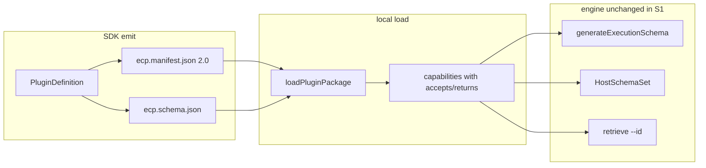

# S1 — Light manifests and per-plugin schema documents

> Implementation plan for PR S1 of [`../schema-scaling-plan.md`](../schema-scaling-plan.md). Drafted by Cursor Agent (plan mode), reviewed and corrected 2026-11-16. Refresh against the code before starting.

S1 ships plugin-manifest **2.0** and per-plugin `ecp.schema.json`, then keeps today’s validation path working by **assembling** full `CapabilityEntry`s in `local` from the light index + schema document. Engine `HostSchemaSet` / `generateExecutionSchema` / L3 stay unchanged until S2/S3.



## Compatibility: how validation keeps working in S1

Today every consumer expects fat entries:

- [`registration.ts` 151–172](../../packages/local/src/plugins/registration.ts) copies `accepts`/`returns`/`configSchema` from the manifest into `CapabilityEntry`
- [`validate.ts` 75–78](../../packages/engine/src/validate/validate.ts) / `validateInput` (91–100) compile `capability.accepts`
- [`operations.ts`](../../packages/engine/src/operations/operations.ts) retrieve-by-id (~121–130), validate/execute/commit (~311/396/635), `startAndAwait` HostSchemaSet (~460) all call `plugins.capabilities()`
- Call-time check uses manifest capability `accepts` ([`registration.ts` 196–199](../../packages/local/src/plugins/registration.ts))
- `configSchema(pluginId)` reads `manifest.configSchema` ([`registration.ts` 181–185](../../packages/local/src/plugins/registration.ts))

**S1 approach (locked; a stepping stone):** S1 still reads every plugin schema document at host start, so it doesn't improve start time yet; lazy reading arrives in S3.

 after a successful load, `LoadedPluginPackage` holds both the light `PluginManifest` and a `PluginSchemaDocument`. `capabilities()`, `configSchema()`, and call-time validation **assemble** today’s shapes from `$defs/<name>.accepts`, `$defs/<name>.returns`, and `$defs.config`. Missing `$defs` keys after a hash-matched load are treated as load failure (`manifestOk: false`). Engine code paths do not change.

**1.0 behaviour (locked):** reject with `manifestOk: false`. AJV `const: "2.0"` fails the old document; also emit an explicit issue message suggesting `ecp-plugin-manifest`. Confirmed today: every writer stamps `PLUGIN_MANIFEST_VERSION` `"1.0"` ([`constants.ts` 32–33](../../packages/protocol/src/constants.ts), [`manifest.ts` 68](../../packages/plugin-sdk/src/manifest.ts)); no published packages. After S1 nothing in-repo writes 1.0.

---

## 1. Spec amendments (S1 owns spec 08 only)

Spec and code must not disagree, so S1 amends only what S1 ships. Spec 03 and 02 amendments land with S2/S3, 09 and 10 with S4, 12 (B8) with S5 (see `s2-s6.md`).

### [`realignment/spec/08-plugins.md`](../spec/08-plugins.md)

**§ `ecp.manifest.json` (102–124)** — rewrite for version **2.0** light index: no `accepts`/`returns`/`configSchema`; add top-level `schema: { path, hash }`. Example JSON shape below under Types.

**After that section** — insert new `## ecp.schema.json` from plan §4.2 (lines 257–267).

**§ Loading steps 2–5 (131–142)** — amend: registry from light manifests; load the schema document with the manifest (S1 assembles full `CapabilityEntry`s eagerly; lazy reading arrives in S3); link mode builds **both** documents in memory; missing/invalid `ecp.schema.json` (non-link) → `manifestOk: false` + suggestion to run `ecp-plugin-manifest`.

**Firefly row (158)** — keep current wording for now; add a note that pending families remain blocked until S6 / this plan’s ship section (do not claim all families shipped in S1).

## 2. New / changed types and JSON Schemas

### Protocol constant

[`packages/protocol/src/constants.ts`](../../packages/protocol/src/constants.ts) line 33:

```ts
export const PLUGIN_MANIFEST_VERSION = "2.0"
```

### Light `PluginManifest` / capability ([`plugins.ts`](../../packages/protocol/src/plugins.ts) 159–212)

```ts
export interface PluginSchemaRef {
  /** Relative path to ecp.schema.json (usually "./ecp.schema.json"). */
  path: string
  /** SHA-256 hex of the canonical JSON of ecp.schema.json. */
  hash: string
}

export interface PluginCapabilityManifest {
  id: string
  name: string
  summary: string
  description: string
  useCases: string[]
  projections: string[]
  timeoutMs?: number
  // NO accepts / returns
}

export interface PluginManifest {
  schema: "@executioncontrolprotocol.plugin-manifest"
  version: "2.0"
  plugin: { id; package; version; summary; description }
  sdkVersion: string
  // NO configSchema
  pluginSchema: PluginSchemaRef
}
```

**Naming decision:** the link to the schema file is `pluginSchema: { path, hash }`. The scaling plan wrote `schema: { path, hash }`, but `schema` is already the document type string on every ECP document, so the field is named `pluginSchema`. Spec 08 uses `pluginSchema`.

### `PluginSchemaDocument` (new in `plugins.ts`)

```ts
export interface PluginSchemaDocument {
  $id: string  // ecp://plugins/<plugin-id>/<version>/schema.json
  $defs: Record<string, Record<string, unknown>>
  // keys: "<capabilityName>.accepts" | "<capabilityName>.returns" | "config"
}
```

Optional `$schema: "https://json-schema.org/draft/2020-12/schema"` may be present on disk; strip or keep consistently — **keep** `$schema` on the written `ecp.schema.json` (draft id), unlike embedded accepts which strip `$schema` today.

### `CapabilityEntry` ([`objects.ts`](../../packages/protocol/src/objects.ts) 306–331)

**Unchanged** — still has `accepts`/`returns`/`configSchema?` (assembled at load).

### `PluginAdapter` ([`services.ts`](../../packages/protocol/src/services.ts) 55–64)

Add:

```ts
loadPluginSchema(pluginId: string): Promise<PluginSchemaDocument | undefined>
```

Implement it on **every** `PluginAdapter`: `LocalPluginRegistration` and the in-memory/fixture adapters used by engine and host tests (search `implements PluginAdapter` and object literals typed `PluginAdapter`).

### `ValidateOptions` ([`validate.ts`](../../packages/engine/src/validate/validate.ts) 21–32)

Add optional (unused in S1 call sites):

```ts
loadPluginSchema?: (pluginId: string) => Promise<PluginSchemaDocument | undefined>
```

### `schemaHash` JSDoc ([`validation.ts`](../../packages/protocol/src/validation.ts) 50–51)

Document target semantics (base + sorted plugin schema hashes) as the **post-S3** meaning; note S1 still hashes the generated combined execution schema. Do not change the computation in S1.

### [`plugin-manifest.schema.json`](../../packages/protocol/schemas/plugin-manifest.schema.json) → 2.0

Full required shape:

```json
{
  "$schema": "https://json-schema.org/draft/2020-12/schema",
  "$id": "ecp://protocol/plugin-manifest.schema.json",
  "type": "object",
  "additionalProperties": false,
  "required": ["schema", "version", "plugin", "sdkVersion", "pluginSchema", "capabilities", "entry", "hash"],
  "properties": {
    "schema": { "const": "@executioncontrolprotocol.plugin-manifest" },
    "version": { "const": "2.0" },
    "plugin": { /* unchanged object */ },
    "sdkVersion": { "type": "string" },
    "pluginSchema": {
      "type": "object",
      "additionalProperties": false,
      "required": ["path", "hash"],
      "properties": {
        "path": { "type": "string", "minLength": 1 },
        "hash": { "type": "string", "pattern": "^[a-f0-9]{64}$" }
      }
    },
    "capabilities": {
      "type": "array",
      "items": {
        "type": "object",
        "additionalProperties": false,
        "required": ["id", "name", "summary", "description", "useCases", "projections"],
        "properties": {
          "id": { "type": "string" },
          "name": { "type": "string" },
          "summary": { "type": "string" },
          "description": { "type": "string" },
          "useCases": { "type": "array", "items": { "type": "string" } },
          "projections": { "type": "array", "items": { "type": "string" } },
          "timeoutMs": { "type": "integer", "minimum": 1 }
        }
      }
    },
    "entry": { "type": "string" },
    "hash": { "type": "string" }
  }
}
```

No `configSchema`, no per-capability `accepts`/`returns`.

### New `packages/protocol/schemas/plugin-schema.schema.json`

Envelope for CI / load validation:

```json
{
  "$schema": "https://json-schema.org/draft/2020-12/schema",
  "$id": "ecp://protocol/plugin-schema.schema.json",
  "type": "object",
  "required": ["$id", "$defs"],
  "properties": {
    "$schema": { "type": "string" },
    "$id": {
      "type": "string",
      "pattern": "^ecp://plugins/.+/[^/]+/schema\\.json$"
    },
    "$defs": {
      "type": "object",
      "minProperties": 1,
      "additionalProperties": { "type": "object" }
    }
  },
  "additionalProperties": true
}
```

---

## 3. Function signatures (plugin-sdk)

In [`manifest.ts`](../../packages/plugin-sdk/src/manifest.ts) (extend; keep `zodToJsonSchema`):

```ts
export interface BuildPluginSchemaOptions {
  definition: PluginDefinition
  packageJson: PackageJsonInfo
}

export async function buildPluginSchemaDocument(
  options: BuildPluginSchemaOptions,
): Promise<PluginSchemaDocument>

export function serializePluginSchema(doc: PluginSchemaDocument): string

// buildPluginManifest changes:
// - version 2.0 via PLUGIN_MANIFEST_VERSION
// - toCapabilityManifest omits accepts/returns
// - omits configSchema
// - after building schema doc, set pluginSchema: { path: "./ecp.schema.json", hash }
// - hash still sha256Hex(canonicalJson(sorted light manifest without hash field))
```

`$id` format: `` `ecp://plugins/${definition.id}/${packageJson.version}/schema.json` ``  
`$defs` keys: `` `${name}.accepts` ``, `` `${name}.returns` ``, and `config` when `definition.config` is set (raw zod→JSON Schema via existing `zodToJsonSchema`).

[`ecp-plugin-manifest.ts`](../../packages/plugin-sdk/src/bin/ecp-plugin-manifest.ts):

```ts
// write mode: write ecp.manifest.json AND ecp.schema.json
// --check: both must exist; byte-equal to freshly built; pluginSchema.hash must equal
//          sha256 of canonical schema doc (fail with clear message if either drifts)
```

Export new APIs from [`index.ts`](../../packages/plugin-sdk/src/index.ts) with JSDoc/`@category Plugins`.

---

## 4. Local loading + assembly

### [`load-manifest.ts`](../../packages/local/src/plugins/load-manifest.ts)

Extend `LoadedPluginPackage`:

```ts
schemaDocument: PluginSchemaDocument
```

**Non-link:**

1. Read + AJV-validate light manifest (2.0).
2. Resolve schema path: `manifest.pluginSchema.path` relative to package root (fallback `package.json` `ecp.schema` then `./ecp.schema.json`).
3. Read JSON; AJV against `plugin-schema.schema.json`; verify `$id` matches plugin id/version; verify every capability has `.accepts`/`.returns` `$defs`; verify `hash(canonical(doc)) === manifest.pluginSchema.hash`.
4. Any failure → `{ ok: false, issues }` with `ECP_PLUGIN_LOAD_FAILED`, message naming the schema file, **suggestion** `Run ecp-plugin-manifest to regenerate.`.
5. Explicit 1.0 / wrong version: same code, message that plugin-manifest 2.0 + `ecp.schema.json` are required.

**Link (`source === "link"`):**

1. Import definition as today (79–128).
2. `buildPluginSchemaDocument` + `buildPluginManifest` in memory (hash link consistent).
3. No disk files required.
4. Return both on `LoadedPluginPackage`.

### [`registration.ts`](../../packages/local/src/plugins/registration.ts)

- `capabilities()`: assemble `accepts`/`returns`/`configSchema` from `loaded.schemaDocument.$defs`.
- `configSchema()`: return `$defs.config`.
- `call()` input check: use assembled accepts (not missing light fields).
- Implement `loadPluginSchema(pluginId)` → in-memory `schemaDocument` for good registrations; `undefined` if missing/failed.
- Do **not** add schemas to Ajv at `start()` (already true).

---

## 5. File-by-file task list (order)

1. **Spec 08** as above (no other spec changes in S1).
2. **protocol** — `PLUGIN_MANIFEST_VERSION`; types in `plugins.ts`; `PluginSchemaDocument`; `PluginAdapter.loadPluginSchema`; JSDoc on `schemaHash`; rewrite `plugin-manifest.schema.json`; add `plugin-schema.schema.json`; export from `index.ts`; update `protocol.test.ts` if it asserts 1.0 / fat capabilities.
3. **engine ValidateOptions** — add optional `loadPluginSchema` field only (no behaviour change).
4. **plugin-sdk** — `buildPluginSchemaDocument` / `serializePluginSchema`; light `buildPluginManifest`; bin writes/checks both; exports; tests.
5. **local** — load both docs; link builds both; assembly in registration; `loadPluginSchema`; update `load-manifest.test.ts` / `plugins.test.ts` hand-written fixtures to 2.0 + schema file.
6. **fixtures** — regenerate/hand-update:
   - `fixtures/plugins/fixture-plugin/`
   - `fixtures/plugins/fixture-creative/`
   - `test/e2e/cli/fixtures/minimal-plugin/`
7. **First-party plugins** — run updated bin for `plugin-test`, `plugin-anthropic`, `plugin-azure-blob-storage`, `plugin-adobe-firefly-services` (commit light `ecp.manifest.json` + new `ecp.schema.json`). Optionally add `"schema": "./ecp.schema.json"` under `package.json` `ecp` (default path still works without it).
8. **Firefly** — no `PENDING_FAMILIES` move (S6). Regenerating via existing `build` → `ecp-plugin-manifest` is enough; generator scripts unchanged.
9. **CI** — [`.github/workflows/ci-pipeline.yml` L92](../../.github/workflows/ci-pipeline.yml) already runs `pnpm run plugins:check-manifests` → bin `--check`; no workflow edit required once bin checks both files. [`scripts/check-plugin-manifests.mjs`](../../scripts/check-plugin-manifests.mjs) unchanged.
10. **Docs touch** — skills/extension-authoring only if it shows a 1.0 fat manifest example (update example to 2.0 + schema file if present).

**Out of S1:** engine marker path, HostSchemaSet base-only, editor split writes, B8 bench, Firefly pending families, deleting wrapValue.

---

## 6. Tests (positive / negative / edge)

| File | Cases |
| --- | --- |
| `packages/plugin-sdk/test/manifest.test.ts` | Positive: light manifest has no accepts/returns/configSchema; `pluginSchema.hash` matches schema doc; deterministic `$id`/`$defs` keys; config → `$defs.config` only. Negative: missing package name/version. Edge: no-config plugin omits `$defs.config`; custom entry/sdkVersion. |
| `packages/plugin-sdk/test/ecp-plugin-manifest-bin.test.ts` (new) | Positive: write creates both files. Negative: `--check` fails if either missing/stale or hash link wrong. Edge: schema content drift with unchanged manifest hash field. |
| `packages/local/test/load-manifest.test.ts` | Positive: link builds both in memory without disk schema. Negative: installed package missing `ecp.schema.json` → not ok + suggestion; corrupt JSON; hash mismatch; 1.0 fat manifest rejected. Edge: `pluginSchema.path` override. |
| `packages/local/test/plugins.test.ts` | Positive: `capabilities()` returns assembled accepts/returns; `configSchema()` from `$defs.config`; `loadPluginSchema` returns doc. Negative: bad schema → `manifestOk: false`, empty capabilities. Update hand-written 1.0 fixtures to 2.0+schema. |
| `packages/protocol/test/protocol.test.ts` | Assert version const `2.0`; schema fixtures if any. |
| Existing engine/e2e | Must stay green unchanged behaviour-wise once fixtures/plugins regenerated (smoke that assemble path works). |

---

## 7. CI changes

None beyond making `ecp-plugin-manifest --check` validate both artifacts (already invoked at [`ci-pipeline.yml:92`](../../.github/workflows/ci-pipeline.yml)). Root `plugins:check-manifests` stays the gate.

---

## 8. Verification commands

```sh
pnpm install
pnpm run build
pnpm run plugins:check-manifests
pnpm run test:unit
pnpm run test:coverage
pnpm run test:integration
pnpm run check
```

Spot-check: `ecp retrieve --type capability --id <id>` returns accepts/returns; `ecp execute` on a fixture still validates.

---

## 9. Exit criteria (S1-only)

- Spec 08 updated (manifest 2.0, `ecp.schema.json`, loading); no other spec changes.
- `PLUGIN_MANIFEST_VERSION === "2.0"`; light schema; `plugin-schema.schema.json` present.
- SDK emits + `--check`s both files; all first-party plugins + fixtures ship both.
- Non-link missing/invalid schema → `manifestOk: false` + regenerate suggestion; link works in memory.
- `PluginAdapter.loadPluginSchema` + optional `ValidateOptions.loadPluginSchema` present.
- Engine validation behaviour unchanged (combined wrapped path still used).
- 1.0 manifests rejected; no in-repo writer left on 1.0.
- `pnpm run check` green.

---

## 10. Risks / open questions (with locked recommendations)

| Item | Recommendation |
| --- | --- |
| Plan field name `schema: { path, hash }` vs document `schema` string | Use **`pluginSchema: { path, hash }`** in JSON/types/spec 08; call out in PR as collision fix. |
| Assembling eagerly in `capabilities()` vs lazy per retrieve | **Eager assembly in `capabilities()` / call / configSchema** in S1 so engine needs zero changes; true laziness lands with S2 registry split. |
| Whether fixtures are regenerated by bin or hand-edited | Prefer bin where a `definePlugin` entry exists; hand-edit static fixtures (`minimal-plugin`, some test temps). |
| `schemaHash` JSDoc vs runtime | Document future semantics; **do not** change hash algorithm in S1. |
| Firefly huge manifest shrink | Expected large diff deleting embeds from `ecp.manifest.json` and adding `ecp.schema.json`; review as generated. |
| Engine tests that construct `CapabilityEntry` inline | Leave as-is (still valid assembled shape). |

---

### Todos

- **specs** — Amend spec 08 only (manifest 2.0 with `pluginSchema`, `ecp.schema.json`, loading)
- **protocol** — Bump PLUGIN_MANIFEST_VERSION to 2.0; light types; PluginSchemaDocument; plugin-manifest + plugin-schema JSON Schemas; PluginAdapter.loadPluginSchema
- **sdk-emit** — buildPluginSchemaDocument + light buildPluginManifest; bin write/--check both files; unit + bin tests
- **local-load** — Load/validate ecp.schema.json; link builds both in memory; assemble CapabilityEntry; reject 1.0 / missing schema
- **regenerate** — Regenerate all first-party plugins + update fixtures/e2e/minimal + local test fixtures
- **verify** — Run build, plugins:check-manifests, coverage, check; confirm engine behaviour unchanged
