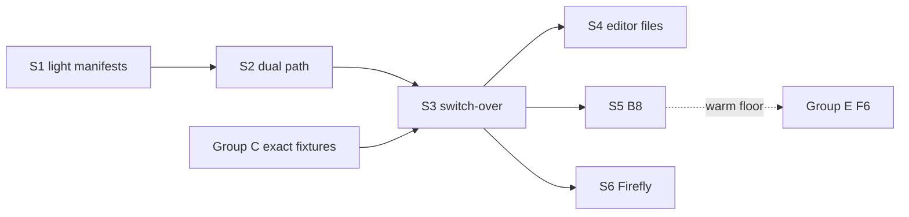
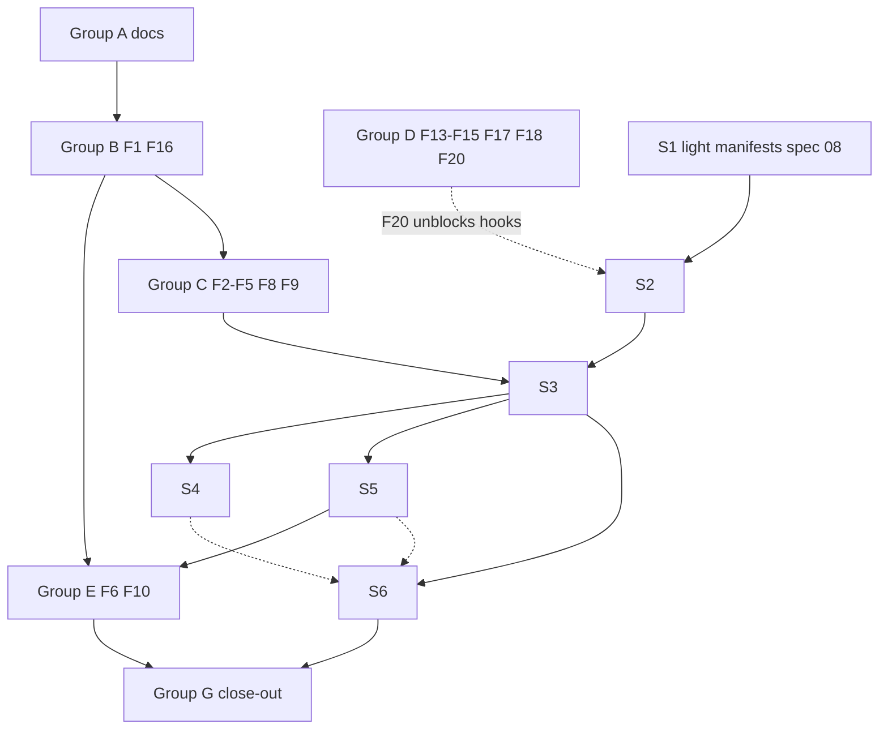

# S2–S6 — Validation at scale

> Implementation plans for PRs S2–S6 of [`../schema-scaling-plan.md`](../schema-scaling-plan.md), written against the S1 contract before S1 landed. Drafted by Cursor Agent (plan mode), reviewed 2026-11-16. **Refresh each PR's plan against the landed code before starting it.** Fix audit F20 (flaky drain test) before S2 so the pre-commit hook doesn't block S-series commits.

## Assumed S1 contract (plan against this; flag deps)

S1 is **not** in the repo yet (`PLUGIN_MANIFEST_VERSION` is still `"1.0"`, no `ecp.schema.json`). Plan as if S1 shipped:

- Light `ecp.manifest.json` **2.0** with **`pluginSchema: { path, hash }`** (not `schema` — that string is the document type).
- Per-plugin `ecp.schema.json` with `$id: ecp://plugins/<plugin-id>/<version>/schema.json` and `$defs` keys `<name>.accepts`, `<name>.returns`, `config`.
- `PluginAdapter.loadPluginSchema(pluginId)` + `ValidateOptions.loadPluginSchema` **exist but unused**.
- [`LocalPluginRegistration.capabilities()`](../../packages/local/src/plugins/registration.ts) still **eagerly** builds full `CapabilityEntry`s (accepts/returns from the schema doc) at load.
- Engine validation **unchanged** (still [`generateExecutionSchema`](../../packages/engine/src/schema/generate.ts) + combined compile).
- S1 amended **only** [spec 08](../spec/08-plugins.md). **S2/S3 own 03 + 02; S4 owns 09/10; S5 owns 12/B8.**

**S1-detail risks:** if S1 names the field `schema` instead of `pluginSchema`, or puts `loadPluginSchema` only on the adapter (not `ValidateOptions`), S2 wiring must follow the landed API. If S1 leaves accepts embedded in the light manifest, S3’s lazy registry work expands.



---

## PR S2 — Engine new path + equivalence (old path stays default)

### Goal

Add `markers.ts` and a **base + lazy raw** `HostSchemaSet` path behind an internal flag / `validateExecutionNext`. Keep today’s wrapped `generateExecutionSchema` path as the **default**. Prove exact `{ code, path, severity }` parity over every execution in `fixtures/` + `examples/` with all real + fixture plugins.

### Spec amendments owned (03 + start of 02)

**Do not** switch Performance rule wording to “runtime never wraps” until S3. In S2:

1. **[03-validation.md](../spec/03-validation.md) L1 table row (line 11)** — append that a dual-path / next validator uses raw accepts + marker filter (default remains generated wrapped schema until S3).

2. **[03](../spec/03-validation.md) after Performance rule (lines 56–61)** — add a short “Next validator (equivalence)” subsection documenting rules **(a)** and **(b)** from the spike (open-object `$script`; marker syntax via base defs). Full replacement of “Generated host schema (L1)” lands in **S3**.

3. **[02-execution-manifest.md](../spec/02-execution-manifest.md) `$script` bullet (lines 128–129)** — change:

   - **Old:** `validated by the generated schema; see 03`
   - **New:** `validated by resolving the capability's raw accepts subschema at that path (must accept a string, or an open object property); see 03. Until the host default switches (S3), the wrapped generated schema remains an equivalent check.`

### File-by-file tasks

| File | Work |
| --- | --- |
| **New** `packages/engine/src/validate/markers.ts` | Port from [`scale3.mjs`](../spikes/schema-scale/scale3.mjs) `validateWithMarkers` (22–42) and [`validate-real.mjs`](../spikes/schema-scale/validate-real.mjs): `collectMarkerPaths`, `filterMarkerExplainedErrors`, `subschemasAt` **with open-object → `true`**, `allowsString` / `isOpenSchema` (move from [`generate.ts`](../../packages/engine/src/schema/generate.ts) 92–105; unify with spike `acceptsString`), `assertScriptPositions`, `collectSecretEnvIssues` (F3-shaped messages; emission wired as issues in next path). |
| [`packages/engine/src/validate/validate.ts`](../../packages/engine/src/validate/validate.ts) | Extend `ValidateOptions` (21–32) to use S1’s `loadPluginSchema`. Add `HostSchemaSet.createBase(...)`: clone base schema, set `$id: ecp://host/execution.schema.json`, compile **base only**; `ensurePluginSchema(pluginId)` → `ajv.addSchema`; `validateCapabilityInput` via `$defs/<name>.accepts` + marker filter. Keep `create()` (76–79) as legacy wrapped path. Add `validateExecutionNext` (or `options.useScalePath`) that: base `validateDocument` → explicit unknown-`uses` check (move enum logic from `mapAjvErrors` 187–201) → per-step raw+filter → script/secret-env extras → existing L2/L3. **Default `validateExecution` unchanged.** |
| [`packages/engine/src/schema/generate.ts`](../../packages/engine/src/schema/generate.ts) | Keep `wrapValue` for legacy + future editor; re-export or import string helpers from `markers.ts` to avoid drift. |
| [`packages/engine/src/index.ts`](../../packages/engine/src/index.ts) | Export marker helpers / next validator only if tests need them. |
| Engine test harness | Wire `loadPluginSchema` from fixture/real plugin `ecp.schema.json` (S1 layout). |

### Tests

| File | Cases |
| --- | --- |
| `packages/engine/test/markers.test.ts` | Port scale3’s **8** cases (pass/fail). **+** open-object `$script` (rule a, `markers.ecp.json`). **+** bad `$script` syntax fails independently of accepts (rule b, `schema-script-both`). **+** `$secret`/`$env` issue shapes (may duplicate false-schema until S3 F3 walk). |
| **`packages/engine/test/validate-scale-equivalence.test.ts`** | Port walk from validate-real (plugins + `fixtures/plugins` manifests; every `.ecp.json` under `fixtures/` + `examples/`). Run **legacy** vs **next** with all capabilities; assert exact equality of projected `{ code, path, severity }` (and F2 uniqueness). Message substring per spec 12 only when both paths emit the same code. |

### Verification

`pnpm run build && pnpm run test:unit -- packages/engine/test/markers.test.ts packages/engine/test/validate-scale-equivalence.test.ts && pnpm run test:coverage`

### Exit criteria

- Equivalence green on Ubuntu + Windows CI for all fixture/example executions.
- Default execute/validate behaviour unchanged (conformance still on legacy path).
- Spec 03 dual-path note + 02 `$script` wording landed.

### Dependencies

- **Requires S1** (`loadPluginSchema`, `ecp.schema.json`, light manifests).
- **∥ Group C** (F2–F5): equivalence uses `{ code, path, severity }`, so C’s exact expected files are **not** required for S2 merge.
- **F20** (Group D): flaky drain can block pre-commit; if hit, fix/isolate per F20 — do not `--no-verify`.

### Risks

- Ajv message text differs → gate on code+path+severity; stabilize `Input does not match…` in next-path `mapAjvErrors`.
- S1 still eager full entries: next path should prefer `$defs` via `loadPluginSchema` even when `CapabilityEntry.accepts` is populated, so S3 lazy cutover is a thin switch.
- Open-object / `acceptsString` semantics must match validate-real or equivalence fails on `fixtures/manifests/valid/markers.ecp.json`.

---

## PR S3 — Switch-over + host-lifetime cache + delete legacy runtime wrap

### Goal

Make the S2 path the **default**; share one `HostSchemaSet` across operations; make the registry **lazy** (light index at start; schema docs on first use; full `CapabilityEntry` for `retrieve --id` assembled lazily); delete runtime combined compile; land F3 dedicated `$secret`/`$env` issues; measure warm `ecp execute` before/after.

### Spec amendments owned (03 full + 02 finalize)

1. **Replace [03](../spec/03-validation.md) “Generated host schema (L1)” + Performance rule (lines 45–61)** with the exact block from [schema-scaling-plan.md §4.1](../schema-scaling-plan.md) (base-only compile; raw accepts + marker filter; rules a/b; `$script` position; `$secret`/`$env` dedicated issues; `schemaHash` = base + sorted plugin schema hashes).

2. **Update L1 table row (line 11)** to “raw accepts + marker filter”, not “generated host schema … wrapped accepts”.

3. **Update Editor support (108–114)** only if S4 hasn’t landed yet — prefer leaving editor bullets for S4; if needed, one sentence: “editor layout in 09; runtime does not compile editor files.”

4. **Finalize [02](../spec/02-execution-manifest.md) `$script` bullet** — drop the “until S3” clause; point solely at raw subschema resolution in 03.

### File-by-file tasks

| File | Work |
| --- | --- |
| [`validate.ts`](../../packages/engine/src/validate/validate.ts) | `validateExecution` → next path only. Remove / stop calling `generateExecutionSchema` for runtime. `schemaHash` from base + plugin schema hashes. `collectSecretEnvIssues` always emitted; dedupe drops `boolean schema is false` (F2+F3). |
| [`operations.ts`](../../packages/engine/src/operations/operations.ts) | Host-lifetime cache: create/reuse one `HostSchemaSet` for validate at **execute ~311**, **resume ~396**, **startAndAwait ~460**, **commit ~635**. Invalidate when plugin set / schemaHash changes (plugin install/link/unload). Pass same instance into `startExecution` (~460) so runtime `validateInput` shares caches. |
| [`registration.ts`](../../packages/local/src/plugins/registration.ts) / load-manifest | Registry holds **light** rows only at `start()`. `loadPluginSchema` reads `ecp.schema.json` on first use. `capabilities()` for listing/`retrieve --query` = light (no accepts embeds). `retrieve --id` (~[`retrieve`](../../packages/engine/src/operations/operations.ts) 122–130) assembles full entry lazily. L1/L3/config/editor call sites get schemas via loader. |
| [`generate.ts`](../../packages/engine/src/schema/generate.ts) | Stop runtime use of wrap; keep `wrapValue` for S4 editor (or move to `editor-schema.ts` in S4 — S3 may leave function in place unused by validate). |
| Conformance / CLI sweep | Sole gate = exact expected issues (Group C). |

### How S3 waits on / re-baselines Group C

**Policy (locked):**

1. **Preferred:** merge Group C (F2 dedupe, F3 messages, F4 `path: string`, F5 exact conformance runner + CLI sweep + corrected `*.expected.json`) **before** merging S3.
2. **If C is not merged:** S3 **must** include a fixture re-baseline in the **same PR**: update every `fixtures/manifests/invalid/*.expected.json` (and conformance assertions) to the next-path exact `{ code, path, severity, message substring }` set; enable exact comparison in the conformance runner if still subset-based. Document in the PR which expected files changed and why (path switch, not silent weaken).
3. S2’s equivalence suite remains the bridge; after S3, delete `validateExecutionLegacy` / dual-path flag; keep or slim equivalence as a regression optional — conformance is the gate.

### Warm execute measurement (F6 evidence)

Before deleting legacy path (or immediately after switch on a branch):

```sh
# hermetic ECP_HOME; all real plugins linked; host warm
ECP_TIMING=1 ecp execute fixtures/.../echo.ecp.json --json   # N times, record median
```

Record median warm execute **before** (combined compile ~3s/`HostSchemaSet.create` per validate-real) vs **after** (cached base + per-cap). Store numbers in the PR body and optionally `bench/baseline/<date>-<os>.json` (F6 convention; dir does not exist yet). Do **not** loosen [`bench/budgets.json`](../../bench/budgets.json) in S3 — that is Group E; S3 only supplies evidence.

### Tests

- Cache: two `validateExecution` + one execute share compile counts / stable `schemaHash`; plugin version bump invalidates.
- Lazy load: unused plugin’s `addSchema` never called; light registry has no embeds.
- Missing/invalid `ecp.schema.json` → `manifestOk: false` + suggestion to run `ecp-plugin-manifest`.
- F3: `$secret`/`$env` at top-level, nested, array, `$script.params` — dedicated messages/suggestions.
- Conformance exact-match green (post-C or re-baselined).
- Delete dual-path once green.

### Verification

`pnpm run check` (full). Spot-check `ecp execute … --validate --json` on invalid fixtures vs expected.

### Exit criteria

- Runtime never `ajv.compile`s a combined marker-wrapped all-capabilities schema.
- Single shared `HostSchemaSet` across the four operations call sites.
- Registry lazy; `retrieve --query` light; `retrieve --id` full lazy.
- Warm execute before/after recorded for E.
- Group C satisfied or fixtures re-baselined in-PR.

### Dependencies

- **S2** merged; **Group C** preferred-first (or re-baseline).
- **∥ / before Group E (F6):** cache should land before E re-budgets warm execute.
- Does **not** require S4/S5/S6.

### Risks

- Message drift vs expected files if C incomplete.
- L3 `dataflow.ts` needs accepts/returns — must load schema doc for used capabilities only.
- Invalidation bugs → stale validators after `ecp plugins link`.

---

## PR S4 — Editor schema files

### Goal

Host writes a **small root** `$ECP_HOME/schema/execution.schema.json` plus per-plugin `schema/plugins/<safe-plugin-id>.editor.schema.json` with **relative `$ref`s**. `wrapValue` becomes **editor-only**. `ecp schema` still prints the root path.

### Spec amendments owned (09 + 10)

1. **[09-host-supervisor-relay.md](../spec/09-host-supervisor-relay.md) Host process (54–56)**

   - **Old:** generate schemas and write `$ECP_HOME/schema/execution.schema.json`
   - **New:** write the root editor schema and per-plugin editor schema files under `$ECP_HOME/schema/plugins/` (relative `$ref`s to `#/$defs/<name>.editorInput`); runtime validation does not compile these files.

2. **[10-cli.md](../spec/10-cli.md) `ecp schema` row (line 26)**

   - **Old:** path of generated `execution.schema.json` …
   - **New:** prints the **root** `execution.schema.json` path (or contents with `--print`); ensures root **and** `schema/plugins/*` editor files are current (host start or in-process write). No new flags.

3. **[03 Editor support](../spec/03-validation.md)** (if not done in S3) — replace lines 108–114 with plan §4.1 Editor support text (root + `schema/plugins/`, relative `$ref`s).

### File-by-file tasks

| File | Work |
| --- | --- |
| New or rename `packages/engine/src/schema/editor-schema.ts` (or keep `generate.ts` editor-only) | `generateEditorRootSchema` (uses dispatch + relative `$ref`s); `generatePluginEditorSchema` with `wrapValue` → `$defs/<name>.editorInput`. **No** runtime call from `HostSchemaSet`. |
| [`create-local-host.ts`](../../packages/host/src/create-local-host.ts) `writeExecutionSchema` (209–217) | Write root + `schema/plugins/*.editor.schema.json` via `loadPluginSchema`; hash for rewrite detection. |
| [`paths.ts`](../../packages/local/src/storage/paths.ts) (89–92) | Add `pluginEditorSchema(pluginId)` under `schema/plugins/`; keep `executionSchema()` as root. |
| [`schema.ts`](../../packages/cli/src/commands/schema.ts) | Still root path (~24); ensure retrieve/touch triggers full editor write. |

### Measuring editor behaviour at 1,000+ capabilities

1. Reuse S5’s synthetic generator (or a small script under `realignment/spikes/schema-scale/`) to install **1,000** light plugins/caps, start host, time `writeExecutionSchema`, record **root file size** and total plugin editor bytes.
2. Open root in **VS Code** JSON language service (`"json.schemas"` → root path): capability `uses` completion, one deep `$ref` into a plugin editorInput, watch for hang / high CPU.
3. **Budgets / fallback (locked):** if root write **> 2 s** or VS Code choke (multi-second freeze on open): shrink root to **`uses` completion only** (enum/pattern of ids, no per-cap input `$ref`s); document in PR; keep per-plugin editor files for optional manual mapping. **Never** reintroduce one giant wrapped runtime/editor file.

### Tests

- Root contains relative `$ref`s only (no inlined wrap blobs).
- Plugin editor file has wrapped `editorInput` defs; `wrapValue` unit tests moved here.
- Write at N=small fixture plugins; optional timed write at 1k in bench/spike (full B8 in S5).

### Verification

`pnpm run build && pnpm run test:unit` (engine/host/cli schema tests) + manual `ecp schema` / `--print`.

### Exit criteria

- Disk layout matches 09; CLI still root-only; runtime validation untouched by editor files.
- Measurement note (or B8 preview) for 1k caps + fallback decision recorded if triggered.

### Dependencies

- **After S3** (schemas load via `loadPluginSchema`; no runtime wrap). Can draft editor generators in parallel but merge after S3.

### Risks

- VS Code resolution of many relative `$ref`s; fallback above.
- Safe plugin id → filename mapping (scoped ids with `/`).

---

## PR S5 — Benchmark B8

### Goal

Add B8 to [`bench/run.mjs`](../../bench/run.mjs) and budgets; CI already runs `pnpm run bench` ([`ci-pipeline.yml`](../../.github/workflows/ci-pipeline.yml) ~207); update A11 + spec 12.

### Spec amendments owned (12 + A11)

1. **[12-testing-and-acceptance.md](../spec/12-testing-and-acceptance.md) benchmarks table (~58–64)** — add:

   `| B8 | Schema scale: host start (incl. registry load of light manifests), first-use compile, cached validate, heap at 1,000 and 5,000 synthetic capabilities; warm ecp execute with all real plugins | synthetic + warm |`

2. **A11 row (~90)** — change `B1–B7` → `B1–B8` when budgets exist.

3. **[`A11.test.ts`](../../test/e2e/acceptance/A11.test.ts)** — assert B8 keys exist in `budgets.json`; assert every budget median is ≤ stated target **or** PR/plan records an exception (F6/F20 alignment with audit A11 fix intent).

### File-by-file tasks

| File | Work |
| --- | --- |
| [`bench/run.mjs`](../../bench/run.mjs) | Synthetic generator: 1,000 / 5,000 Firefly-sized caps as **real on-disk packages** (light `ecp.manifest.json` + `ecp.schema.json`). Metrics: host start **including registry load**; first-use compile; cached validate; heap; warm `ecp execute` echo with **all real** plugins. |
| [`bench/budgets.json`](../../bench/budgets.json) | Add B8 scenario keys (e.g. `B8-start-1k`, `B8-start-5k`, `B8-first-use-median`, `B8-cached-validate`, heap recorded even if soft). Targets from plan §10: start ≈ flat (≤ ~100 ms overhead beyond empty at 5k); first-use ≤ **50 ms**/cap median; cached ≤ **1 ms**. |
| `bench/baseline/<date>-<os>.json` | Commit if following F6 convention (results/ stays gitignored). |
| CI | Existing `bench` job; ensure B8 runtime acceptable (may use fewer iterations). |

### Tests / verification

`pnpm run bench` on Ubuntu (CI) + Windows locally; `pnpm run test:e2e` A11.

### Exit criteria

- B8 in runner + budgets; A11/spec 12 updated; warm-execute sub-metric available for Group E.

### Dependencies

- **After S3** (lazy registry + base compile). Editor write time can be a B8 sub-metric if S4 merged; otherwise measure validation only.
- **Informs Group E (F6)** re-budget; does not replace F1/oclif work (Group B).

### Risks

- CI time/disk for 5k packages — generate under temp `ECP_HOME`, cap iterations.
- Budget too tight on Windows — record OS-specific exception per F6 rules, don’t silently loosen.

---

## PR S6 — Ship pending Firefly families

### Goal

Unblock and ship the six pending families after validation scales.

### Spec / audit owned

1. **[08-plugins.md](../spec/08-plugins.md) Firefly row (~158)** — after ship: “all generated families except skipped `content-tagging`”; capability count 63 (content-tagging is skipped and not counted).
2. Tick **F7 checkboxes** in [`mvp-audit-fixes.md`](../mvp-audit-fixes.md) (Decision recorded; Families shipped) with PR link.

### File-by-file tasks

| File | Work |
| --- | --- |
| [`generate.mjs`](../../plugins/plugin-adobe-firefly-services/scripts/lib/generate.mjs) (~55–65) | Move all of `PENDING_FAMILIES` into `GENERATED_FAMILIES`; leave `PENDING_FAMILIES = []` (or remove); keep `SKIPPED_FAMILIES = content-tagging`. |
| Regenerate | `src/generated/**`, `ecp.manifest.json`, `ecp.schema.json`, `meta.json`. |
| [`generator.test.ts`](../../plugins/plugin-adobe-firefly-services/test/generator.test.ts) | `describe.each` over all generated families; drop “pending generate-clean” as separate non-ship; metadata `useCases`/`projections` for new families. |
| Handlers / mocked-fetch | Per family: one representative capability — happy, error map (`ECP_PROVIDER_ERROR` + body), abort (`stubFetch` in [`test/helpers.ts`](../../plugins/plugin-adobe-firefly-services/test/helpers.ts)). |
| [`README.md`](../../plugins/plugin-adobe-firefly-services/README.md) | Expand with capability list **per family** (currently 7 lines, no list). |

### Verification

`pnpm run plugins:check-manifests`, plugin unit tests, `pnpm run check`. Smoke: host start + validate an execution using a new-family capability id.

### Exit criteria

- 63 capabilities shipped (content-tagging stays skipped); F7 ticked; README + spec 08 updated; no Ajv stack overflow on host start / validate.

### Dependencies

- **After S3** (hard). S4/S5 preferred before or with S6 so editor/B8 cover full Firefly set, but S6 can merge once S3 is green.

### Risks

- Snapshot churn; OpenAPI overlay gaps in a pending family — fix overlays or document deferral in 08 (audit allows document-instead-of-ship per family with reason).

---

## Combined dependency graph (S1–S6 + audit B–G)



| Edge | Meaning |
| --- | --- |
| S1 → S2 | `pluginSchema`, `ecp.schema.json`, `loadPluginSchema` |
| S2 → S3 | Dual path proven; then default + delete legacy |
| C → S3 | Exact fixtures **or** re-baseline in S3 |
| S3 → S4/S5/S6 | Lazy schemas + no runtime wrap |
| S5 → E | Warm execute floor after schema cache |
| B → E | F1 before meaningful F6 budgets |
| F20 ∈ D | Flaky drain can block any S-PR pre-commit |

---

## Single ordered schedule

1. **S1** (assumed done / land first) — light manifests, SDK emit, spec 08 only; engine unchanged.
2. **Group B** early if not done — F1 before trusting warm timings.
3. **S2 ∥ Group C ∥ Group D** — S2 equivalence; C exact fixtures; D includes F20.
4. **S3** — after S2 **and** (C merged **or** re-baseline in S3); host cache + lazy registry; measure warm execute.
5. **S4** then **S5** (S4 first so B8 can optionally include editor write); S5 informs **Group E**.
6. **S6** Firefly families after S3 (ideally after S4/S5).
7. **Group E** re-budget with S3/S5 evidence; **Group G** close-out (F7 retrospective, etc.).
